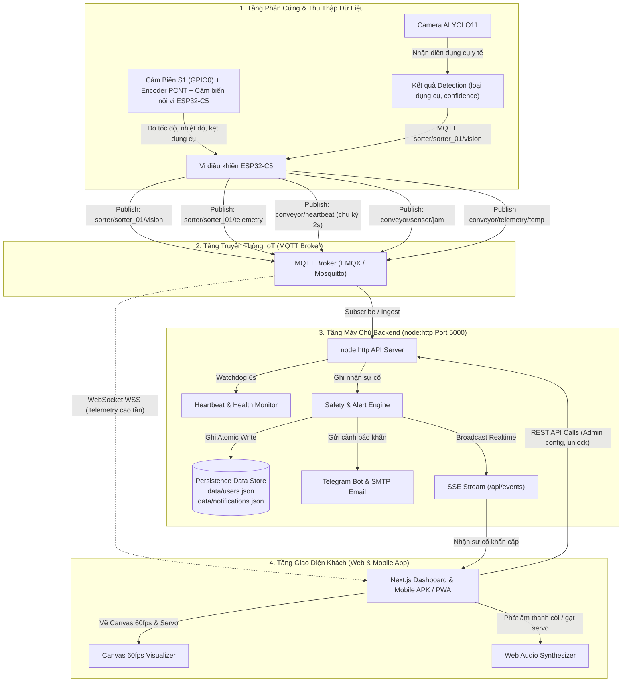
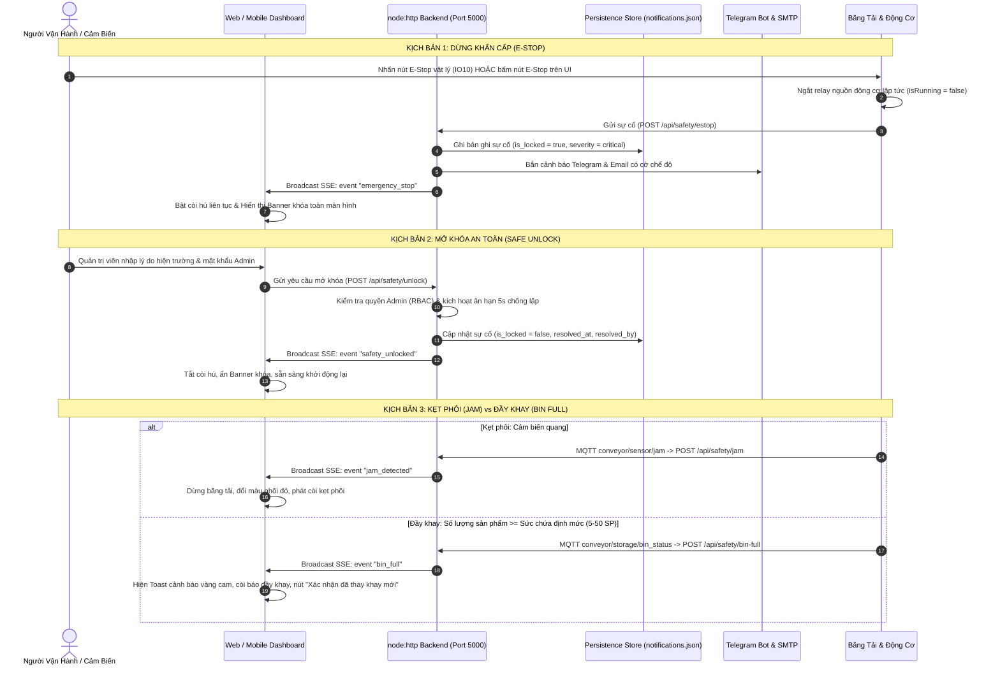
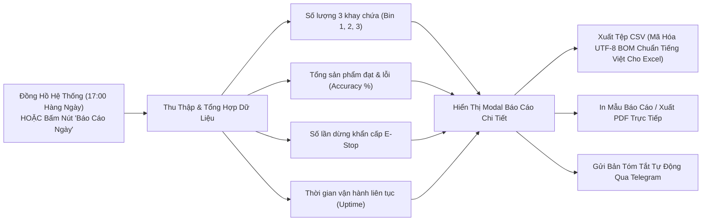
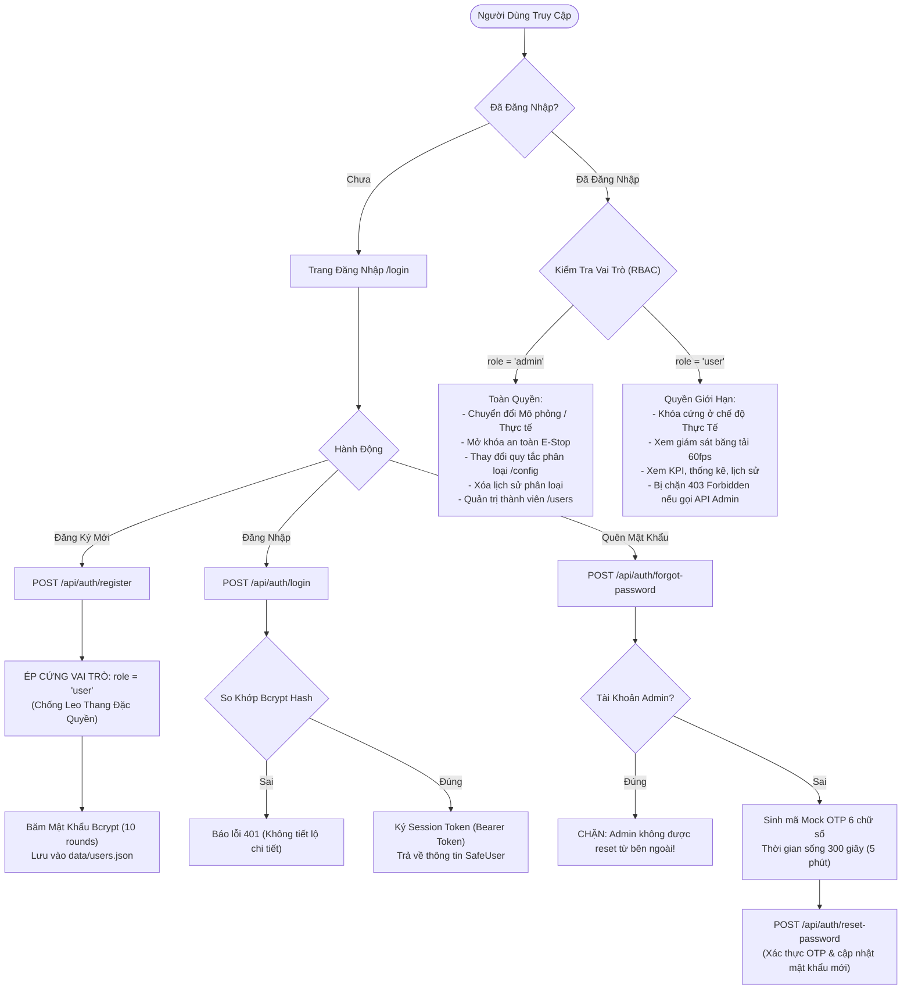
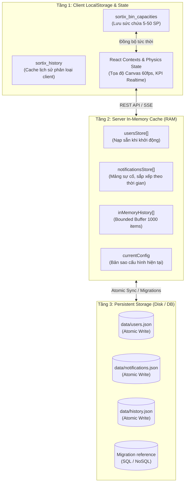

# SortiX-Med — Hệ Thống Tự Động Phân Loại Dụng Cụ Y Tế & Chuẩn Bị Khử Trùng Phòng Mổ (Biomedical & Industrial IoT)

> **Đồ án PBL3 / Capstone Project**: Hệ thống điều khiển, giám sát và tự động phân loại dụng cụ y tế sau phẫu thuật (Bơm kim tiêm / Dao mổ, Kẹp phẫu thuật Pean, Kéo phẫu thuật, Lọ thuốc / Ống nghiệm) theo thời gian thực trên băng tải thông minh nhằm chuẩn bị cho quy trình khử trùng Autoclave phòng mổ. Tích hợp vi điều khiển IoT (**ESP32-C5**), camera thị giác máy tính (**YOLO11 AI**), bảng điều khiển quản trị phân tầng và ứng dụng di động đa nền tảng (Android APK & iOS PWA) từ một cơ sở mã nguồn duy nhất (1-Codebase Hybrid Architecture).

---

## Ghi chú về cấu trúc runtime hiện tại

Phần mô tả chi tiết bên dưới được giữ lại để làm tài liệu nghiệp vụ và vận hành. Các điểm sau là nguồn sự thật cho cấu trúc code hiện tại:

### Monorepo và entrypoint

- Root dùng npm workspaces cho `frontend`, `backend` và `shared`.
- `frontend` là Next.js 14 App Router, chạy cổng `3000`, gồm page routes và các route handlers tại `frontend/src/app/api`.
- `backend` là HTTP server TypeScript dùng module chuẩn `node:http`, chạy cổng `5000`; không dùng Express. `backend/src/server.ts` điều phối route trực tiếp, còn controllers/routes/services/middlewares cung cấp các lớp nghiệp vụ.
- `shared` chứa `types`, `schemas` và `constants` được dùng ở cả hai workspace.
- Persistence runtime hiện có là `data/history.json`, `data/notifications.json`, `data/sync_state.json` và `data/users.json`; `ConfigModel` giữ cấu hình mặc định trong bộ nhớ. Các migration/seed trong `backend/database` được giữ làm tài liệu triển khai, không được script hiện tại tự động chạy.

### Cây thư mục thực tế

```text
SortiX-Dashboard/
├─ frontend/src/app/              # /, /alerts, /analytics, /config, /conveyor,
│  ├─ /devices, /history, /login, /users
│  └─ api/                        # auth, config, history, events, safety, stats,
│                                  # sync, alerts, chat/copilot, telegram/webhook, users
├─ frontend/src/components/       # layout (TopHeader, Sidebar, DashboardLayout),
│                                  # overview, conveyor, ui, users, widgets, AiCopilot
├─ frontend/src/hooks/            # useSorterData, useMQTT, useConveyorPhysics, useThemeAudio
├─ frontend/capacitor.config.ts   # webDir: capacitor-shell, server.url từ CAPACITOR_SERVER_URL
├─ backend/src/                   # server.ts (node:http native :5000), controllers,
│                                  # routes, middlewares, models, services, config, utils
├─ backend/database/              # migrations và seeds tham chiếu (PostgreSQL, MySQL, SQLite, MongoDB)
├─ shared/                        # types, schemas, constants dùng chung giữa Frontend, Backend & Firmware
├─ data/                          # JSON runtime store: history, notifications, sync_state, telemetry_logs, users
├─ scripts/                       # dev-all.cjs, telegram-poller.cjs, e2e.cjs, free-port.cjs, dev.ps1, test.ps1
├─ tests/                         # 26 file unit test suites tự động (175/175 unit tests PASS 100%)
├─ docs/                          # architecture.md, api.md
```

### Lệnh chính hiện có

```powershell
npm run dev              # Frontend Next.js tại :3000
npm run dev:backend      # build rồi start backend tại PORT (mặc định :5000)
npm run dev:all          # Điều phối 3-trong-1 (Frontend :3000 + Backend :5000 + Telegram Bot Poller)
npm run dev:telegram     # Khởi động riêng tiến trình Telegram Bot Long-Polling Gateway
npm run build            # build tối ưu hóa frontend Next.js (33/33 routes)
npm run lint             # next lint
npm run build --workspace=backend
npx tsc --noEmit --pretty false
npm test                 # Chạy toàn bộ 26 test suites tự động (175/175 unit tests PASS 100%)
npm run test:e2e         # contract desktop/mobile/Capacitor
npm run cap:sync
npm run cap:open
```

`npm test` hiện chạy toàn bộ **26 file test suites** tự động với **175/175 unit tests PASS 100%** qua lệnh `node --test tests/*.test.cjs`. Bộ kiểm thử bao phủ toàn diện: `security_audit_remediation`, `history`, `api_schemas`, `users`, `estop_safety`, `jam_detection`, `simulation_mode_guard`, `jam_simulation_audio`, `bin_full`, `temperature_warning`, `device_offline`, `shift_summary`, `bin_sliders_sync`, `mqtt_disconnected`, `temperature_gauge_simulation_vs_real`, `daily_report_sync`, `cross_device_sync`, `http_telemetry_history`, `daily_production_cumulative`, `four_user_requests_upgrade`, `mute_siren_feature`, `new_day_report_tele_email`, `anti_ai_industrial_scada_ui`, `auto_stop_on_all_items_in_trays`, `ghost_item_prevention`, và `telegram_copilot_2way_and_screenfit`.

Các mục lịch sử bên dưới có thể mô tả trạng thái ở thời điểm phát hành cũ. Khi có khác biệt, phần ghi chú runtime này và source code hiện tại được ưu tiên.

## 📌 Mục Lục
1. [Giới Thiệu Tổng Quan](#1-giới-thiệu-tổng-quan)
2. [Kiến Trúc Hệ Thống (Monorepo & 1-Codebase Architecture)](#2-kiến-trúc-hệ-thống-monorepo--1-codebase-architecture)
3. [Luồng Hoạt Động & Quy Trình Vận Hành (System Workflows)](#3-luồng-hoạt-động--quy-trình-vận-hành-system-workflows)
   - 3.1. [Sơ Đồ Luồng Hoạt Động Tổng Thể (End-to-End Workflow)](#31-sơ-đồ-luồng-hoạt-động-tổng-thể-end-to-end-workflow)
   - 3.2. [Luồng Phân Loại Dụng Cụ Y Tế Máy Thật (Live Hardware Sorting Flow)](#32-luồng-phân-loại-sản-phẩm-máy-thật-live-hardware-sorting-flow)
   - 3.3. [Luồng Phân Loại Ở Chế Độ Mô Phỏng (Simulation Physics Flow)](#33-luồng-phân-loại-ở-chế-độ-mô-phỏng-simulation-physics-flow)
   - 3.4. [Luồng An Toàn Công Nghiệp & Xử Lý Sự Cố (Safety & Incident Flow)](#34-luồng-an-toàn-công-nghiệp--xử-lý-sự-cố-safety--incident-flow)
   - 3.5. [Luồng Báo Cáo 1 Ngày Làm Việc (Shift Summary Workflow)](#35-luồng-báo-cáo-1-ngày-làm-việc-shift-summary-workflow)
   - 3.6. [Luồng Cấu Hình Quy Tắc Phân Loại (Configuration Sync Flow)](#36-luồng-cấu-hình-quy-tắc-phân-loại-configuration-sync-flow)
   - 3.7. [Luồng Xác Thực Người Dùng & Phân Quyền RBAC (Auth & Access Control)](#37-luồng-xác-thực-người-dùng--phân-quyền-rbac-auth--access-control)
4. [Cơ Chế Hoạt Động Của Cơ Sở Dữ Liệu (Database Architecture)](#4-cơ-chế-hoạt-động-của-cơ-sở-dữ-liệu-database-architecture)
   - 4.1. [Chiến Lược Lưu Trữ 2 Tầng (Dual-Mode Persistence Strategy)](#41-chiến-lược-lưu-trữ-2-tầng-dual-mode-persistence-strategy)
   - 4.2. [Cơ Chế Ghi File Nguyên Tử (Atomic File Write Mechanism)](#42-cơ-chế-ghi-file-nguyên-tử-atomic-file-write-mechanism)
   - 4.3. [Chi Tiết Các Bảng & Thực Thể Dữ Liệu (Entities & Schemas)](#43-chi-tiết-các-bảng--thực-thể-dữ-liệu-entities--schemas)
   - 4.4. [Cơ Chế Đồng Bộ Dữ Liệu 3 Lớp (3-Tier Data Synchronization)](#44-cơ-chế-đồng-bộ-dữ-liệu-3-lớp-3-tier-data-synchronization)
   - 4.5. [Bộ Migrations Đa CSDL Sẵn Sàng Triển Khai (Multi-DB Migrations)](#45-bộ-migrations-đa-csdl-sẵn-sàng-triển-khai-multi-db-migrations)
5. [Công Nghệ Sử Dụng](#5-công-nghệ-sử-dụng)
6. [Tài Khoản Mặc Định & Phân Quyền (RBAC)](#6-tài-khoản-mặc-định--phân-quyền-rbac)
7. [Cài Đặt & Khởi Chạy Nhanh](#7-cài-đặt--khởi-chạy-nhanh)
8. [Đóng Gói Ứng Dụng Di Động (Mobile App: Android APK & iOS PWA)](#8-đóng-gói-ứng-dụng-di-động-mobile-app-android-apk--ios-pwa)
9. [Chế Độ Vận Hành: Mô Phỏng vs. Máy Thật](#9-chế-độ-vận-hành-mô-phỏng-vs-máy-thật)
10. [Các Trang Chức Năng Chính](#10-các-trang-chức-năng-chính)
11. [Hệ Thống An Toàn, Giám Sát & Cảnh Báo](#11-hệ-thống-an-toàn-giám-sát--cảnh-báo)
12. [Hệ Thống Xác Thực & Bảo Mật](#12-hệ-thống-xác-thực--bảo-mật)
13. [Kiểm Thử & Đảm Bảo Chất Lượng (QA)](#13-kiểm-thử--đảm-bảo-chất-lượng-qa)
14. [Biến Môi Trường (Environment Variables)](#14-biến-môi-trường-environment-variables)
15. [Xử Lý Sự Cố Thường Gặp (Troubleshooting)](#15-xử-lý-sự-cố-thường-gặp-troubleshooting)
16. [Nhóm Tác Giả & Đóng Góp](#16-nhóm-tác-giả--đóng-góp)

---

## 1. Giới Thiệu Tổng Quan

**SortiX-Med** là hệ thống IoT Y tế chuyên dụng phục vụ công tác thu gom, tự động nhận diện và phân loại dụng cụ phẫu thuật phòng mổ. Hệ thống giải quyết bài toán chống lây nhiễm chéo các tác nhân nguy hiểm (HIV, HBV, HCV...) và phòng chống tai nạn nghề nghiệp do vật sắc nhọn đâm phải cho đội ngũ y bác sĩ và kỹ thuật viên y tế.

### 🌟 Tính năng nổi bật:
- 🚀 **Trực quan hóa vật lý 60fps (HTML5 Canvas & 2D Digital Twin)**: Mô phỏng chi tiết 4 nhóm dụng cụ y tế (Bơm tiêm/Dao mổ, Kẹp phẫu thuật Pean, Kéo mổ, Ống nghiệm) di chuyển trên băng tải, qua cảm biến quang và phân luồng chính xác vào 3 khay chứa y tế chuyên dụng.
- 📱 **Hỗ Trợ Di Động Đa Nền Tảng (1-Codebase Hybrid Mobile App)**:
  - **Android**: Đóng gói thành file `.apk` cài đặt trực tiếp thông qua **Capacitor 8**, tích hợp splash screen, cấu hình `usesCleartextTraffic` và webview hiệu năng cao.
  - **iOS (iPhone/iPad)**: Chế độ PWA Standalone toàn màn hình (qua Safari "Thêm vào MH chính"), tối ưu viewport chuẩn `viewportFit: "cover"`, chống zoom ngoài ý muốn (`maximumScale: 1, userScalable: false`).
  - **Tối ưu trải nghiệm cảm ứng di động**: Thanh điều hướng dạng ngăn kéo (Drawer Sidebar), nút chuyển đổi chế độ Mô phỏng/Thực tế dạng viên nang (Pill Button) ngay trên TopHeader và thanh menu Sidebar.
- 🎚️ **Độ Rộng & Sức Chứa Khay Tùy Chỉnh (Dynamic Bin Capacities 5 - 50 SP)**: Mỗi khay cho phép tùy chỉnh định mức chứa từ 5 đến 50 sản phẩm qua thanh trượt mượt mà; tự động đồng bộ tức thời giữa thanh trượt máng trượt Canvas, Widget giám sát, trang Cấu hình và LocalStorage.
- 🌡️ **Đồng Hồ Đo Nhiệt Độ Bán Nguyệt (Dual-Mode Temperature Gauge)**: 
  - *Chế độ Mô phỏng*: Cung cấp thanh trượt ảo (30°C - 95°C) và các nút đặt nhanh (42.5°C, 72.0°C, 78.5°C) để thử nghiệm phản ứng quá nhiệt.
  - *Chế độ Thực tế*: Tự động ẩn thanh trượt giả lập, hiển thị bảng telemetry phần cứng (cảm biến nội vi tích hợp trên chip ESP32-C5) với nhãn `[PHẦN CỨNG THẬT]` và kim đo nhảy theo telemetry thực.
- 📡 **Giám Sát Kết Nối IoT & Mạng Đa Tầng**:
  - Tự động phát hiện mất kết nối MQTT Broker quá 5 giây (`mqtt_disconnected`), đổi huy hiệu Header sang đỏ chớp nháy, phát còi cảnh báo và tự động kết nối lại theo lịch trình (3s -> 5s -> 10s).
  - Watchdog 6 giây giám sát nhịp tim định kỳ 2 giây (`conveyor/heartbeat`), cảnh báo tức thì khi vi điều khiển ESP32 ngoại tuyến (`device_offline`).
- 🤖 **Trợ Lý AI Copilot 2 Chiều & Telegram Bot Gateway**:
  - Tích hợp mô hình Google Gemini 3.5 Flash Lite (`gemini-3.5-flash-lite`) với độ trễ phản hồi cực thấp (~1s) trực tiếp qua API v1beta (không phụ thuộc middleware n8n).
  - Tương tác 2 chiều thông minh qua Telegram Bot (`@SortiX_Med_Bot`): Kỹ sư và điều dưỡng có thể nhắn tin hỏi đáp phân tích telemetry thời gian thực, đồng thời điều khiển hệ thống SCADA từ xa an toàn qua bàn phím Inline Keyboard (`/status`, `/temp`, `/estop`, `/start`, `/stop`, `/clear_bin`).
  - Tích hợp tiến trình `scripts/telegram-poller.cjs` tự động chạy ngầm trong lệnh điều phối `npm run dev:all`.
- 🖥️ **SCADA Kiosk Fullscreen & Display Density (Fit Màn Hình Zero-Scroll)**:
  - Chuyển đổi linh hoạt giữa 2 chế độ hiển thị: **Gọn gàng (Compact)** tối ưu hóa mật độ điểm ảnh cho màn hình cảm biến công nghiệp, và **Tiêu chuẩn (Comfortable)**.
  - Nút bấm và phím tắt Toàn màn hình **F11 SCADA Kiosk** cho phòng điều khiển trung tâm, chống tràn viền và fit màn hình không cuộn (zero-scroll) cho trang Băng Tải (`/conveyor`).
  - Thiết kế TopHeader chống đè lấn (overlap) chữ và badge trên mọi độ phân giải (1024px đến 4K).
- 📋 **Báo Cáo 1 Ngày Làm Việc (Shift Summary)**:
  - Đồng bộ trực tiếp dữ liệu phân loại thực tế: số lượng 3 khay chứa, số sản phẩm đạt/lỗi, tỷ lệ chính xác, số lần dừng khẩn cấp và thời gian vận hành.
  - Hỗ trợ xem Modal thống kê, xuất báo cáo CSV có UTF-8 BOM hiển thị tiếng Việt chuẩn trên Excel, và mẫu in ấn / xuất PDF chuyên nghiệp.
- 🔊 **Âm thanh công nghiệp thuần (Web Audio API)**: Bộ phát âm thanh tổng hợp tín hiệu âm thanh cảnh báo còi hú, còi khay đầy, còi quá nhiệt, còi mất kết nối, tiếng servo gạt kim loại và nạp phôi mà không phụ thuộc file âm thanh ngoài.
- 👥 **Quản lý người dùng & Phân quyền chặt chẽ (RBAC)**: Đầy đủ các luồng Đăng ký, Đăng nhập, Đổi mật khẩu, Quên mật khẩu OTP, Khóa/Mở tài khoản và chống leo thang đặc quyền.
- 🚨 **Cảnh báo đa kênh & An toàn công nghiệp**:
  - Tự động gửi Email (SMTP) và tin nhắn khẩn cấp qua Telegram Bot kèm nhãn định danh chế độ vận hành (`🧪 Chế độ Giả Lập` / `🔴 Phần cứng Thực Tế`).
  - Hệ thống **Dừng khẩn cấp (E-Stop)**: Dừng băng chuyền lập tức, còi hú liên tục, banner khóa an toàn, chỉ Admin có quyền mở khóa kèm lý do hiện trường và cơ chế chống kẹt loop echo 5s.
  - Phân định rõ ràng **Đầy khay (`bin_full`)** vs **Kẹt phôi (`jam_detected`)**: Đầy khay khi số lượng đạt định mức (ví dụ 30/30 hoặc 50/50 SP); Kẹt phôi khi cảm biến quang học #02 che khuất liên tục > 5 giây.
- 🔒 **Cô lập Chế độ Vận hành**: Toàn bộ nút giả lập thử nghiệm chỉ xuất hiện ở chế độ Mô phỏng, hoàn toàn bị ẩn và chặn ở chế độ Thực tế để bảo vệ dữ liệu phần cứng.

---

## 2. Kiến Trúc Hệ Thống & Cây Thư Mục Chi Tiết (Architecture & Directory Structure)

Mã nguồn được tổ chức theo chuẩn **Monorepo (npm workspaces)** với mô hình **1-Codebase**: toàn bộ Web máy tính, Cloud Vercel, ứng dụng di động Android APK và iOS PWA đều chia sẻ 100% logic và giao diện.

### 2.1. Sơ Đồ Cây Thư Mục Tổng Thể

```text
SortiX-Dashboard/
├── backend/                  # Workspace Máy chủ Backend độc lập (node:http + TypeScript, Port 5000)
│   ├── database/             # Quản lý cấu trúc dữ liệu và tài khoản quản trị
│   │   ├── migrations/       # Scripts SQL/JS tạo bảng và chỉ mục (PostgreSQL, SQLite, MySQL, MongoDB)
│   │   └── seeds/            # Dữ liệu hạt giống (Seed 4 tài khoản Admin cố định băm mật khẩu Bcrypt)
│   ├── scripts/              # Scripts hỗ trợ đóng gói bản build (patch-dist-aliases.cjs)
│   ├── src/                  # Mã nguồn TypeScript máy chủ API
│   │   ├── config/           # Nạp, kiểm tra và bảo vệ biến môi trường (env.ts)
│   │   ├── controllers/      # Tầng điều phối HTTP request/response cho từng phân hệ
│   │   ├── middlewares/      # Lớp lọc trung gian: Xác thực JWT, Kiểm tra Zod, Bắt lỗi tập trung
│   │   ├── models/           # Tầng truy xuất và thao tác tệp dữ liệu bền vững (Atomic File I/O)
│   │   ├── routes/           # Định tuyến RESTful API endpoints (/api/auth, /api/safety, ...)
│   │   ├── services/         # Tầng lõi nghiệp vụ: Safety Engine, SSE Broadcast, Mqtt, Email/Tele Alert
│   │   ├── utils/            # Tiện ích định dạng thông báo sự cố, rate limiter, lọc bảo mật
│   │   └── server.ts         # Điểm khởi động HTTP Server, đăng ký routes, thiết lập CORS và Watchdog
│   ├── package.json          # Cấu hình phụ thuộc và scripts cho package @sortix/backend
│   └── tsconfig.json         # Cấu hình biên dịch TypeScript cho backend
├── frontend/                 # Workspace Giao diện Web Next.js 14 App Router & Mobile Shell
│   ├── android/              # Dự án Native Android Studio (Capacitor Bridge đóng gói APK)
│   │   ├── app/              # Mã nguồn native Android, AndroidManifest.xml, output file APK
│   │   └── build.gradle      # Cấu hình Gradle build hệ điều hành Android
│   ├── capacitor-shell/      # Vỏ WebView tối thiểu (index.html) để Capacitor đồng bộ Native App
│   ├── public/               # Tài nguyên tĩnh công khai (SortiX-Dashboard.apk, icon, ảnh hero, QR code)
│   ├── src/                  # Mã nguồn TypeScript & React
│   │   ├── app/              # Định tuyến trang Next.js App Router và Next.js API Route Handlers
│   │   ├── components/       # Thư viện thành phần giao diện UI mô-đun hóa cao
│   │   ├── contexts/         # Quản lý trạng thái xác thực và phân quyền (AuthContext.tsx)
│   │   ├── hooks/            # Custom React Hooks: vật lý băng tải, kết nối MQTT, dữ liệu telemetry
│   │   ├── lib/              # Thư viện tiện ích client: Web Audio synthesizer, xuất CSV, LocalStorage history
│   │   └── services/         # API Client SDK giao tiếp với Backend REST API và Server-Sent Events (SSE)
│   ├── capacitor.config.ts   # Cấu hình ứng dụng di động Capacitor (App ID, Server URL, Cleartext)
│   ├── next.config.mjs       # Cấu hình máy chủ Next.js và tối ưu hóa đóng gói
│   ├── package.json          # Cấu hình phụ thuộc và scripts cho package @sortix/frontend
│   ├── tailwind.config.ts    # Thiết lập hệ thống màu sắc HSL, hiệu ứng SCADA và giao diện Dark/Light
│   └── tsconfig.json         # Cấu hình TypeScript với Path Aliases (@/* và @shared/*)
├── shared/                   # Workspace Thư viện Dùng Chung giữa Frontend, Backend và Firmware
│   ├── constants/            # Hằng số toàn hệ thống: Danh sách Topic MQTT, mã màu khay, danh mục đồ y tế
│   ├── schemas/              # Zod validation schemas kiểm tra tính toàn vẹn payload (hỗ trợ .passthrough())
│   ├── types/                # Khai báo kiểu dữ liệu tĩnh TypeScript chuẩn hóa cho toàn dự án
│   ├── package.json          # Cấu hình package @sortix/shared
│   └── tsconfig.json         # Cấu hình TypeScript cho shared workspace
├── data/                     # Cơ sở dữ liệu JSON cục bộ bền vững (Persistence Data Store)
│   ├── users.json            # Hồ sơ thành viên, mật khẩu băm, vai trò phân quyền (RBAC)
│   ├── notifications.json    # Nhật ký các thông báo sự cố (E-Stop, Jam, Đầy khay, Quá nhiệt)
│   ├── history.json          # Nhật ký phân loại sản phẩm thực tế từ băng chuyền
│   ├── sync_state.json       # Lưu trữ trạng thái đồng bộ cấu hình giữa Web, App và ESP32
│   └── telemetry_logs.json   # Lưu trữ telemetry thời gian thực phục vụ giám sát
├── docs/                     # Tài liệu kỹ thuật chi tiết phục vụ phát triển và chuyển giao
│   ├── architecture.md       # Thiết kế kiến trúc phân tầng, nguyên tắc an toàn công nghiệp và SCADA
│   └── api.md                # Đặc tả toàn diện RESTful API routes, format payload, SSE và mã lỗi HTTP
├── scripts/                  # Bộ công cụ tự động hóa, điều phối môi trường dev và kiểm thử
│   ├── dev-all.cjs           # Khởi động song song cả Frontend Next.js và Backend Node.js
│   ├── free-port.cjs         # Tự động quét và giải phóng cổng mạng 3000/5000 bị kẹt trước khi chạy
│   ├── e2e.cjs               # Kịch bản kiểm thử luồng tích hợp tự động đầu-cuối (End-to-End)
│   ├── telegram-poller.cjs   # Bộ lắng nghe webhook Telegram độc lập phục vụ debug tại mạng local
│   ├── dev.ps1               # Lệnh PowerShell chạy nhanh môi trường phát triển trên Windows
│   └── test.ps1              # Lệnh PowerShell thực thi nhanh toàn bộ bộ kiểm thử tự động
├── tests/                    # Bộ 26 suite kiểm thử tự động Contract & Integration Tests (*.test.cjs)
├── .env.example              # Mẫu khai báo biến môi trường chuẩn cho dự án
├── .env.local                # Biến môi trường cục bộ phục vụ chạy thử nghiệm
├── .gitignore                # Khai báo các tệp và thư mục loại trừ khỏi Git (node_modules, .next, dist)
├── .vercel/                  # Metadata liên kết dự án triển khai tự động lên Vercel Cloud
├── vercel.json               # Cấu hình chỉ thị build Monorepo Workspace cho Vercel
├── package.json              # Tệp quản lý Monorepo root: workspaces, dependencies dùng chung và lệnh chạy
├── package-lock.json         # Khóa phiên bản gói phụ thuộc chính xác của npm
├── tsconfig.json             # Cấu hình TypeScript gốc định nghĩa đường dẫn tắt toàn hệ thống
├── README.md                 # Tài liệu hướng dẫn sử dụng, cài đặt và vận hành hệ thống
├── CHANGELOG.md              # Nhật ký phát triển và lịch sử cập nhật phiên bản chi tiết
├── AGENTS.md                 # Quy chuẩn kỹ thuật, tiêu chuẩn giao diện SCADA và quy tắc bảo mật
└── SortiX_Dashboard.png      # Mã QR kết nối nhanh ứng dụng di động cho nhân viên vận hành
```

---

### 2.2. Vai Trò & Tác Dụng Chi Tiết Của Từng Thư Mục

#### 🏢 1. Phân hệ Máy chủ Backend (`backend/`)
Chịu trách nhiệm xử lý logic nghiệp vụ trung tâm, lưu trữ dữ liệu bền vững, kết nối MQTT Broker với vi điều khiển ESP32, giám sát nhịp tim (watchdog), và phát tín hiệu cảnh báo khẩn cấp:
- **`backend/database/`**:
  - `migrations/`: Chứa các script SQL/JS để tự động khởi tạo bảng cơ sở dữ liệu nếu chuyển từ JSON Store sang SQLite, PostgreSQL, MySQL hoặc MongoDB.
  - `seeds/`: Tệp hạt giống khởi tạo cố định 4 tài khoản Quản trị viên (`admin1` đến `admin4`) kèm mật khẩu băm Bcrypt an toàn.
- **`backend/scripts/`**: Chứa `patch-dist-aliases.cjs`, script tự động chuyển đổi các alias TypeScript thành đường dẫn tương đối Node.js sau khi biên dịch vào thư mục `dist/`.
- **`backend/src/config/`**: Quản lý biến môi trường (`env.ts`), đảm bảo các biến nhạy cảm như `JWT_SECRET`, cổng kết nối và thông tin MQTT broker được nạp đúng chuẩn.
- **`backend/src/controllers/`**: Các bộ điều khiển HTTP (Request Handlers):
  - `alertController.ts`: Tiếp nhận và xử lý cảnh báo khẩn cấp gửi về từ client hoặc IoT.
  - `configController.ts`: Tiếp nhận, xác thực và xuất bản cấu hình phân loại (`SorterConfig`).
  - `historyController.ts`: Truy vấn, lọc và phân trang lịch sử phân loại sản phẩm.
  - `safetyController.ts`: Xử lý kích hoạt/giải trừ Dừng khẩn cấp (E-Stop), Kẹt phôi (Jam), Quá nhiệt và Đầy khay.
  - `statsController.ts` & `telemetryController.ts`: Tổng hợp số liệu KPI và đọc ghi telemetry.
  - `userController.ts`: Đăng nhập, đăng ký, đổi mật khẩu, quản lý thành viên và phân quyền RBAC.
- **`backend/src/middlewares/`**:
  - `authMiddleware.ts`: Kiểm tra JSON Web Token (JWT) trong header Authorization và phân định vai trò `admin` / `user`.
  - `validateMiddleware.ts`: Tự động kiểm tra payload HTTP body dựa trên Zod Schema trước khi đưa vào controller.
  - `errorMiddleware.ts`: Bắt lỗi ngoại lệ toàn cục, bảo đảm server không bao giờ bị crash khi có lỗi bất ngờ.
- **`backend/src/models/`**: Tầng thao tác tệp dữ liệu bền vững (Data Access Layer) với cơ chế ghi nguyên tử (**Atomic Write via Temporary File + Rename**) giúp chống hỏng tệp khi mất điện đột ngột:
  - `userModel.ts`: Đọc/ghi và cập nhật danh sách người dùng trong `data/users.json`.
  - `notificationModel.ts`: Quản lý các bản ghi thông báo sự cố trong `data/notifications.json`.
  - `configModel.ts`, `historyModel.ts`, `telemetryModel.ts`: Quản lý cấu hình, lịch sử và telemetry.
- **`backend/src/routes/`**: Tập hợp các tệp khai báo route RESTful (`authRoutes.ts`, `safetyRoutes.ts`, `userRoutes.ts`, ...).
- **`backend/src/services/`**: Trái tim logic nghiệp vụ của hệ thống:
  - `safetyService.ts`: Xử lý logic khóa an toàn E-Stop, mở khóa kèm lý do hiện trường, cơ chế chống kẹt echo loop 5s, và kích hoạt còi báo động.
  - `sseService.ts`: Quản lý các kết nối thời gian thực Server-Sent Events (`/api/events`), đẩy thông báo sự cố tức thì đến mọi màn hình giám sát.
  - `alertNotificationService.ts`: Tự động soạn thảo và gửi tin nhắn cảnh báo qua Telegram Bot và Email SMTP khi xảy ra sự cố nghiêm trọng.
  - `mqttService.ts`: Kết nối trực tiếp tới MQTT Broker, subscribe các topic telemetry/vision từ ESP32 và kích hoạt watchdog khi thiết bị offline > 6 giây.
  - `userService.ts`: Logic mã hóa Bcrypt, xác thực mật khẩu, quản lý mã OTP khôi phục tài khoản.
- **`backend/src/server.ts`**: Tệp khởi động chính của Backend, tích hợp HTTP server native (`node:http`), xử lý CORS, phân phối route và kích hoạt dịch vụ MQTT.

---

#### 💻 2. Phân hệ Giao diện Khách & Ứng dụng Di động (`frontend/`)
Xây dựng trên nền tảng **Next.js 14 App Router** kết hợp **Capacitor Mobile Shell**, mang lại trải nghiệm màn hình giám sát công nghiệp SCADA trên Web và ứng dụng di động bản địa:
- **`frontend/android/`**: Dự án mã nguồn native Android Studio hoàn chỉnh. Cho phép biên dịch trực tiếp ra file cài đặt `SortiX-Dashboard.apk` với cấu hình bật kết nối mạng nội bộ Cleartext Traffic và giao diện SCADA toàn màn hình.
- **`frontend/capacitor-shell/`**: Chứa tệp `index.html` tối thiểu làm trang neo (webDir) cho bộ công cụ Capacitor CLI đồng bộ cấu hình sang nền tảng native.
- **`frontend/public/`**: Thư mục lưu trữ tài nguyên tĩnh được máy chủ Next.js phân phối công khai:
  - `SortiX-Dashboard.apk`: File cài đặt ứng dụng Android để người dùng tải trực tiếp từ nút bấm trên Dashboard.
  - `SortiX_Dashboard.png`: Ảnh mã QR để nhân viên dùng camera điện thoại quét và mở ứng dụng ngay lập tức.
  - `smart_sorter_hero.jpg`: Hình ảnh đồ họa hệ thống băng tải y tế hiển thị trên giao diện trang chủ.
- **`frontend/src/app/`**: Hệ thống phân trang (Page Routes) và API Serverless:
  - `page.tsx`: Trang Tổng Quan Hệ Thống với các thẻ thống kê KPI, biểu đồ phân loại, widget nhịp tim thiết bị và danh sách hoạt động gần nhất.
  - `conveyor/page.tsx`: Trang Giám Sát Băng Tải trực quan thời gian thực với khung vẽ **Canvas 60fps**, hiển thị vật thể di chuyển mượt mà, thanh điều khiển actuator và giám sát cảm biến quang S1/S2/S3.
  - `analytics/page.tsx`: Trang Phân Tích Dữ Liệu Chuyên Sâu với biểu đồ cột, biểu đồ tròn (Recharts) theo dõi năng suất ca làm việc, tỷ lệ thành công và phân bổ khay.
  - `history/page.tsx`: Bảng tra cứu toàn bộ lịch sử phân loại dụng cụ y tế, hỗ trợ lọc đa tiêu chí và xuất báo cáo CSV chuẩn UTF-8 BOM tiếng Việt.
  - `alerts/page.tsx`: Trung tâm quản lý cảnh báo và sự cố công nghiệp, phân loại theo mức độ Nghiêm trọng (Critical), Cảnh báo (Warning) và Thông tin (Info).
  - `users/page.tsx`: Trang Quản trị Thành viên & Phân quyền (Dành riêng cho Admin): Tạo mới, sửa vai trò, khóa tài khoản và thiết lập lại mật khẩu.
  - `login/page.tsx`: Giao diện đăng nhập hiện đại, đăng ký tài khoản mới và quên mật khẩu qua mã xác thực OTP.
  - `settings/config/page.tsx`: Trang Cấu hình Quy tắc Phân loại (gán loại dụng cụ vào khay 1, khay 2 hoặc khay 3 mặc định) và dung lượng tối đa của từng khay.
  - `settings/devices/page.tsx`: Trang Giám sát Telemetry Phần cứng IoT (tốc độ encoder, nhiệt độ vi xử lý, cường độ WiFi RSSI, trạng thái kết nối MQTT).
  - `config/` & `devices/` & `settings/`: Các trang điều hướng ngược thông minh (Redirect Pages) đảm bảo người dùng hoặc liên kết cũ luôn được chuyển tiếp tự động về đúng địa chỉ mới mà không gặp lỗi 404.
  - `frontend/src/app/api/`: Các Next.js Route Handlers cung cấp các API độc lập khi chạy trên Vercel Serverless (`/api/auth`, `/api/safety`, `/api/events`, `/api/sync`, `/api/telegram-alert`, ...).
- **`frontend/src/components/`**: Các khối giao diện tái sử dụng:
  - `conveyor/`: `ActuatorTestPanel` (bảng kích hoạt thử nghiệm tay gạt servo), `ConveyorStations` (vị trí các trạm cảm biến), `VisualItemRenderer` (vẽ hình ảnh ống tiêm, kẹp phẫu thuật, kéo y tế).
  - `layout/`: `DashboardLayout` (bộ khung tổng thể, hỗ trợ chuyển đổi chế độ xem SCADA Kiosk toàn màn hình F11), `TopHeader` (nút chuyển Dark/Light, hiển thị trạng thái khẩn cấp Mobile Pill), `Sidebar` (menu điều hướng), các Banner cảnh báo (`EmergencyStopBanner`, `BinFullIncidentBanner`).
  - `overview/`: `KpiStatGrid` (lưới chỉ số sản xuất), `LiveHealthAndBinWidget` (thanh đo nhiệt độ và dung lượng khay), `RecentActivityList` (danh sách sự kiện trực tiếp).
  - `ui/`: Các cửa sổ tương tác an toàn (`EmergencyConfirmModal` xác nhận mở khóa E-Stop kèm nhập lý do, `TemperatureGaugeWidget` đồng hồ đo nhiệt độ, `ShiftSummaryModal` tổng kết ca sản xuất, và các Toast thông báo trạng thái).
  - `AiCopilot.tsx`: Trợ lý Trí tuệ Nhân tạo thông minh tích hợp Google Gemini AI và n8n workflow, hỗ trợ hỏi đáp kỹ thuật và hướng dẫn vận hành thiết bị.
  - `ConveyorVisualizer.tsx`: Khối vẽ Canvas thời gian thực mô phỏng chuyển động vật lý của băng chuyền theo vận tốc encoder.
- **`frontend/src/contexts/`**: `AuthContext.tsx` quản lý phiên đăng nhập của người dùng, tự động làm mới JWT token và cung cấp hook phân quyền `usePermission("user.manage")` để bảo vệ các nút chức năng nhạy cảm.
- **`frontend/src/hooks/`**: Chứa logic xử lý tương tác độc lập:
  - `useConveyorPhysics.ts`: Tính toán tọa độ và gia tốc di chuyển của phôi trên băng tải 60 lần mỗi giây.
  - `useMQTT.ts`: Quản lý kết nối WebSocket MQTT bảo đảm dữ liệu telemetry từ broker EMQX đổ về UI liên tục.
  - `useSorterData.ts`: Quản lý dữ liệu phân loại, bộ đếm khay và chuyển đổi linh hoạt giữa chế độ Mô phỏng và Thực tế.
- **`frontend/src/lib/`**: Bộ công cụ kỹ thuật client:
  - `audioService.ts`: Bộ tổng hợp âm thanh Web Audio API (không cần tải file mp3 bên ngoài), phát âm thanh còi hú báo động E-Stop, tiếng gạt khay và âm thanh click giao diện.
  - `history.ts`: Hệ thống lưu trữ dữ liệu lịch sử vào LocalStorage có khả năng phân tách độc lập giữa chế độ Giả lập và Thực tế, tự động dọn dẹp dữ liệu cũ khi khởi động lại.
  - `exportCsv.ts`: Bộ tạo file Excel/CSV chuẩn UTF-8 có BOM (Byte Order Mark) chống lỗi font tiếng Việt khi mở bằng Microsoft Excel.
- **`frontend/src/services/`**: Các lớp API Client (SDK) trừu tượng hóa các cuộc gọi mạng HTTP fetch tới máy chủ backend (`apiAuthClient`, `apiSafetyClient`, `apiUsersClient`, `sseService`).

---

#### 🔗 3. Tầng Dùng Chung (`shared/`)
Đảm bảo tính nhất quán dữ liệu tuyệt đối giữa giao diện Web, máy chủ Backend và firmware điều khiển:
- **`shared/constants/`**: Khai báo các hằng số không thay đổi: Danh mục định danh dụng cụ phẫu thuật (`CATALOG_BRANDS`), bảng màu sắc chuẩn nhận diện khay (`BIN_THEMES`), danh sách các chủ đề MQTT chuẩn mực (`conveyor/safety/estop`, `sorter/sorter_01/telemetry`, ...) và cấu hình mặc định ban đầu.
- **`shared/schemas/`**: Tập hợp các Zod Schema kiểm định cấu trúc dữ liệu:
  - `TelemetrySchema`: Kiểm tra nhịp tim, tốc độ băng tải, nhiệt độ CPU, trạng thái cảm biến.
  - `VisionDetectionSchema`: Kiểm tra kết quả AI Camera (tên dụng cụ, độ tin cậy confidence).
  - `SorterConfigSchema`: Kiểm tra tính hợp lệ của quy tắc chia khay, sử dụng `.passthrough()` để cho phép firmware ESP32 bổ sung trường tùy biến mà không gây lỗi phân tích.
  - `AlertPayloadSchema`: Kiểm định dữ liệu gửi tin nhắn Telegram và Email.
- **`shared/types/`**: Định nghĩa các TypeScript Interface chuẩn mực (`ClassificationRecord`, `TelemetryData`, `AlertEvent`, `UserSession`, ...), giúp các lập trình viên frontend và backend luôn hiểu chung một định dạng dữ liệu.

---

#### 🗄️ 4. Lưu Trữ Dữ Liệu Bền Vững (`data/`)
Nơi lưu trữ dữ liệu thực tế của hệ thống ở định dạng JSON bền vững, không phụ thuộc vào cài đặt database bên ngoài, phù hợp cho triển khai nhẹ và chạy demo:
- **`users.json`**: Lưu trữ danh sách tài khoản thành viên, vai trò `admin`/`user`, mật khẩu đã băm Bcrypt, và trạng thái hoạt động.
- **`notifications.json`**: Lưu trữ lịch sử toàn bộ các thông báo sự cố công nghiệp (E-Stop, kẹt vật phẩm, đầy khay, quá nhiệt) kèm trạng thái đã giải quyết hay chưa.
- **`history.json`**: Bản ghi lịch sử các đợt phân loại dụng cụ y tế thực tế từ băng chuyền.
- **`sync_state.json`**: Lưu phiên bản cấu hình phân loại và trạng thái đồng bộ giữa máy chủ và vi điều khiển.
- **`telemetry_logs.json`**: Nhật ký lưu vết các thông số đo đạc vi điều khiển theo thời gian.

---

#### 📚 5. Tài Liệu Kỹ Thuật Dự Án (`docs/`)
- **`architecture.md`**: Bản thiết kế kiến trúc chi tiết, giải thích các tầng công nghệ, quy tắc an toàn công nghiệp E-Stop, giải pháp SCADA hiển thị không cuộn trang (zero-scroll), và luồng đồng bộ đa thiết bị.
- **`api.md`**: Đặc tả kỹ thuật toàn diện của tất cả các REST API endpoints trong hệ thống: Phương thức HTTP (GET/POST/PUT/DELETE), cấu trúc Header, dữ liệu Body mẫu, phản hồi thành công và định dạng lỗi.

---

#### ⚙️ 6. Bộ Scripts Điều Phối & Tự Động Hóa (`scripts/`)
- **`dev-all.cjs`**: Script điều phối trung tâm, tự động giải phóng cổng mạng và khởi động song song cả Frontend Next.js (port 3000) và Backend Node.js (port 5000) chỉ bằng một lệnh duy nhất.
- **`free-port.cjs`**: Tiện ích quét và tắt các tiến trình Node.js chạy ngầm đang chiếm dụng cổng 3000 hoặc 5000 trên Windows, tránh lỗi `EADDRINUSE`.
- **`e2e.cjs`**: Kịch bản chạy kiểm thử luồng tích hợp đầu-cuối: Tự động khởi động server, giả lập người dùng đăng nhập, kích hoạt E-Stop, kiểm tra còi hú, và xác nhận tắt hệ thống an toàn.
- **`telegram-poller.cjs`**: Công cụ lắng nghe tin nhắn Telegram 2 chiều độc lập phục vụ việc kiểm thử trợ lý điều khiển từ xa khi chạy ở môi trường máy tính cá nhân (localhost).
- **`dev.ps1`** & **`test.ps1`**: Các tệp lệnh tắt PowerShell tối ưu hóa cho môi trường phát triển Windows, giúp khởi động dev server hoặc chạy test suite nhanh chóng.

---

#### 🧪 7. Bộ Kiểm Thử Tự Động (`tests/`)
Chứa **26 test suites kiểm thử tự động** (thực thi thông qua lệnh `npm test` bằng Node.js Test Runner):
- Kiểm thử logic an toàn E-Stop, cơ chế chống lặp echo và mở khóa có lý do (`estop_safety.test.cjs`, `security_audit_remediation.test.cjs`).
- Kiểm thử phân biệt Đầy khay vs Kẹt phôi (`bin_full.test.cjs`, `jam_detection.test.cjs`).
- Kiểm thử cảnh báo quá nhiệt động cơ và máy chủ AI (`temperature_warning.test.cjs`, `temperature_gauge_simulation_vs_real.test.cjs`).
- Kiểm thử mất kết nối MQTT và vi điều khiển ngoại tuyến (`mqtt_disconnected.test.cjs`, `device_offline.test.cjs`).
- Kiểm thử phân quyền tài khoản, chống leo thang đặc quyền và xác thực OTP (`users.test.cjs`).
- Kiểm thử xuất báo cáo ca sản xuất và đồng bộ Telegram/Email (`shift_summary.test.cjs`, `new_day_report_tele_email.test.cjs`).
- Kiểm thử đồng bộ dữ liệu lịch sử và schema API (`history.test.cjs`, `api_schemas.test.cjs`).
- Kiểm thử giao diện công nghiệp SCADA không tràn màn hình và âm thanh báo động (`telegram_copilot_2way_and_screenfit.test.cjs`, `jam_simulation_audio.test.cjs`, `mute_siren_feature.test.cjs`).

---

#### 📄 8. Các Tệp Tin Cấu Hình Cấp Gốc (Root Configuration Files)
- **`package.json`**: Định nghĩa cấu hình Monorepo Workspaces (`"workspaces": ["frontend", "backend", "shared"]`), quản lý các lệnh chạy tổng thể (`npm run dev:all`, `npm test`, `npm run build`).
- **`package-lock.json`**: Tệp khóa cây phân giải thư viện bảo đảm toàn bộ thành viên nhóm phát triển cài đặt đúng phiên bản phụ thuộc.
- **`tsconfig.json`**: Cấu hình TypeScript cho toàn bộ dự án, thiết lập đường dẫn tắt `@/*` trỏ tới `frontend/src/*` và `@shared/*` trỏ tới `shared/*`.
- **`vercel.json`**: Cấu hình chỉ thị nền tảng đám mây Vercel tự động nhận diện và triển khai thư mục workspace `frontend`.
- **`.env.example`**: Bảng mẫu các biến môi trường cấu hình (Broker MQTT, JWT Secret, Token Telegram, SMTP Mailer, Gemini API Key).
- **`.env.local`**: Tệp lưu trữ biến môi trường thực tế khi chạy thử nghiệm trên máy tính cá nhân.
- **`SortiX_Dashboard.png`**: Ảnh mã QR độ phân giải cao phục vụ nhân viên quét để truy cập nhanh Dashboard trên thiết bị di động.
- **`README.md`**: Tài liệu hướng dẫn tổng quan toàn diện về hệ thống.
- **`CHANGELOG.md`**: Nhật ký chi tiết toàn bộ các mốc phát triển, tính năng mới và các bản sửa lỗi qua từng phiên bản.
- **`AGENTS.md`**: Quy định kỹ thuật, quy tắc an toàn và hướng dẫn bắt buộc dành cho lập trình viên và trợ lý AI khi làm việc trên dự án.

---

## 3. Luồng Hoạt Động & Quy Trình Vận Hành (System Workflows)

Phần này mô tả chi tiết cách thức toàn bộ hệ thống phối hợp từ phần cứng IoT, thị giác máy tính, MQTT Broker, máy chủ API cho đến giao diện người dùng.

### 3.1. Sơ Đồ Luồng Hoạt Động Tổng Thể (End-to-End Workflow)



---

### 3.2. Luồng Phân Loại Dụng Cụ Y Tế Máy Thật (Live Hardware Sorting Flow)

1. **Dụng cụ đi vào băng tải**: Động cơ băng tải quay với vận tốc được giám sát qua cảm biến Encoder (`conveyor_speed`). Dụng cụ y tế sau phẫu thuật lần lượt đi qua Cảm biến S1 (IO0 - Phát hiện vật vào và kích hoạt cụm camera).
2. **Camera AI YOLO11 nhận diện dụng cụ y tế**:
   - Camera công nghiệp tại trạm nhận diện chụp ảnh khi dụng cụ đi qua vùng ROI của Cảm biến S1.
   - Mô hình Vision AI YOLO11 phân loại 4 nhóm dụng cụ y tế và xuất độ tin cậy `confidence` (0.00 – 1.00):
     - `med_syringe`: Bơm kim tiêm / Dao mổ (Vàng y tế `#EAB308`)
     - `med_forceps`: Kẹp phẫu thuật Pean (Xanh dương y tế `#0284C7`)
     - `med_scissors`: Kéo phẫu thuật (Xanh tím tiệt trùng `#6366F1`)
     - `med_vial`: Lọ thuốc / Ống nghiệm (Xanh ngọc Emerald `#10B981`)
   - Kết quả được đóng gói vào payload `VisionDetection` và gửi lên MQTT topic `sorter/sorter_01/vision`.
3. **Tra cứu quy tắc phân loại & Cơ chế An toàn Fail-safe**:
   - ESP32-C5 so khớp `brand` với bảng quy tắc cấu hình `rules` hiện tại:
     - `med_syringe` -> **Khay 1: Thùng vật sắc nhọn lây nhiễm (Sharps Waste)** (Servo 1 - PWM GPIO6 gạt vào khay)
     - `med_forceps` / `med_scissors` -> **Khay 2: Khay hấp tiệt trùng Autoclave (Surgical Instruments)** (Servo 2 - PWM GPIO24 gạt vào khay)
     - `med_vial` -> **Khay 3: Khay vật tư y tế & Phục hồi** (Chạy thẳng cuối băng tải qua máng trượt trọng lực, không kích hoạt servo)
     - **Nguyên tắc An toàn Sinh học (Fail-safe)**: Mọi vật phẩm không nhận diện được hoặc độ tin cậy `confidence < 60%` (0.60) sẽ tự động chạy thẳng vào **Khay 3** để nhân viên y tế kiểm tra lại, tuyệt đối không gạt nhầm vào Khay 2 tiệt trùng.
4. **Kích hoạt cơ cấu Servo gạt theo Tracking Encoder**:
   - Bộ đếm xung phần cứng New PCNT (GPIO1 & GPIO4) kết hợp FIFO Tracking Ring Buffer (tối đa 15 phôi) tính toán khoảng cách thực tế dụng cụ di chuyển trên băng chuyền (200 mm tới Servo 1, 400 mm tới Servo 2).
   - Khi vật thể đến đúng cửa sổ kích hoạt (cửa sổ dung sai 15 mm), vi điều khiển kích hoạt Servo tương ứng qua FSM Non-blocking LEDC PWM để gạt dụng cụ vào đúng khay.
5. **Cập nhật dữ liệu & Lịch sử**:
   - Số đếm khay tăng thêm 1 sản phẩm.
   - Bản ghi phân loại `ClassificationRecord` được gửi về backend qua API `POST /api/history` và lưu vào bộ nhớ đệm an toàn.
   - Dashboard hiển thị tức thời hoạt ảnh và âm thanh phản hồi.

---

### 3.3. Luồng Phân Loại Ở Chế Độ Mô Phỏng (Simulation Physics Flow)

1. **Khởi tạo dụng cụ ảo**:
   - Người vận hành bấm nút nạp nhanh trên thanh điều khiển (`ConveyorToolbar` / `ActuatorTestPanel`):
     - 💉 Bơm tiêm / Dao mổ (`med_syringe`)
     - 🗜️ Kẹp phẫu thuật Pean (`med_forceps`)
     - ✂️ Kéo phẫu thuật (`med_scissors`)
     - 🧪 Lọ thuốc / Ống nghiệm (`med_vial`)
     - Hoặc bấm "Nạp ngẫu nhiên" để sinh phôi ngẫu nhiên.
   - Đối tượng dụng cụ được khởi tạo với tọa độ `x = 0`, vận tốc `vx`, khối lượng, kích thước và màu sắc y tế tương ứng.
2. **Vòng lặp vật lý Canvas 60fps (`useConveyorPhysics.ts`)**:
   - Vòng lặp `requestAnimationFrame` tính toán tọa độ di chuyển theo thời gian thực ($x_{new} = x_{old} + vx \times \Delta t$).
   - Khi dụng cụ đi qua tọa độ trạm kiểm tra (Cảm biến S1), hệ thống mô phỏng quét cảm biến quang học và hiển thị hiệu ứng quét laser AI.
3. **Mô phỏng cơ cấu gạt chuyển hướng**:
   - Dựa trên quy tắc phân loại, khi dụng cụ đến tọa độ Khay 1 ($x \approx 280px$) hoặc Khay 2 ($x \approx 480px$), cơ cấu gạt ảo kích hoạt góc quay.
   - Dụng cụ nhận gia tốc theo trục $y$, đổi hướng và trượt vào lòng khay tương ứng.
   - Nếu là Khay 3 (`med_vial` hoặc độ tin cậy < 60%), dụng cụ tiếp tục chạy thẳng đến cuối băng tải và rơi vào Khay 3.
4. **Tổng hợp số liệu & Hiệu ứng**:
   - Bộ đếm khay trên máng trượt Canvas và widget `LiveHealthAndBinWidget` nhảy số, phát âm thanh công nghiệp qua Web Audio API (`playSortChime()`).
   - Kiểm tra ngưỡng sức chứa định mức của khay (5 - 50 SP). Nếu đạt mức tối đa, tự động kích hoạt cảnh báo đầy khay ảo.

---

### 3.4. Luồng An Toàn Công Nghiệp & Xử Lý Sự Cố (Safety & Incident Flow)

Hệ thống SortiX triển khai cơ chế an toàn phân tầng nghiêm ngặt nhằm bảo vệ thiết bị và người vận hành:



- **Mất kết nối Vi điều khiển (`device_offline`)**:
  - ESP32-C5 gửi gói tin nhịp tim mỗi 2 giây lên topic `conveyor/heartbeat`.
  - Bộ đếm thời gian (Watchdog) phía backend kiểm tra: nếu quá **6 giây** không nhận được nhịp tim, hệ thống tự động phát cảnh báo thiết bị ngoại tuyến (`device_offline`).
- **Mất kết nối MQTT Broker (`mqtt_disconnected`)**:
  - Trình duyệt và App di động duy trì kết nối WebSocket tới MQTT Broker.
  - Áp dụng cơ chế **Debounce 5 giây** để loại bỏ tình trạng nhấp nháy mạng ngắn hạn. Nếu mất kết nối thực sự quá 5 giây, hệ thống chuyển huy hiệu TopHeader sang `MQTT: DISCONNECTED (Đỏ chớp nháy)`, phát âm thanh cảnh báo và kích hoạt quy trình tự động kết nối lại theo chu kỳ tăng dần (**3s -> 5s -> 10s**).

---

### 3.5. Luồng Báo Cáo 1 Ngày Làm Việc (Shift Summary Workflow)



---

### 3.6. Luồng Cấu Hình Quy Tắc Phân Loại (Configuration Sync Flow)

1. **Người dùng điều chỉnh cấu hình**: Quản trị viên truy cập trang `/config`, gán nhóm dụng cụ y tế vào khay đích (ví dụ: `med_syringe` -> Khay 1: Sắc nhọn; `med_forceps` & `med_scissors` -> Khay 2: Tiệt trùng; Khay mặc định: Khay 3: Vật tư/Mặc định) và tùy chỉnh độ rộng/sức chứa khay (5 – 50 SP).
2. **Kiểm định dữ liệu đầu vào**: Frontend đóng gói payload và gửi `POST /api/config`. Middleware Zod tại backend kiểm tra tính hợp lệ qua `SorterConfigSchema.passthrough()`.
3. **Tăng Version & Xuất bản**: Backend tăng số hiệu `config_version` tự động, lưu vào bộ nhớ cấu hình và xuất bản thông điệp MQTT lên topic `sorter/01/config`.
4. **Áp dụng tại phần cứng**: Vi điều khiển ESP32-C5 nhận thông điệp qua MQTT, nạp cấu hình mới vào bộ nhớ RAM/EEPROM theo chế độ `apply_mode` ("áp dụng ngay lập tức" hoặc "đợi khi băng tải trống").

---

### 3.7. Luồng Xác Thực Người Dùng & Phân Quyền RBAC (Auth & Access Control)



---

## 4. Cơ Chế Hoạt Động Của Cơ Sở Dữ Liệu (Database Architecture)

Hệ thống dữ liệu của SortiX được thiết kế theo tiêu chuẩn độ tin cậy cao, hỗ trợ cả môi trường phát triển (Zero-Setup) lẫn môi trường công nghiệp sản xuất (Enterprise Database).

### 4.1. Chiến Lược Lưu Trữ 2 Tầng (Dual-Mode Persistence Strategy)

```
┌────────────────────────────────────────────────────────────────────────┐
│                        TẦNG DỮ LIỆU SORTIX                             │
├──────────────────────────────────┬─────────────────────────────────────┤
│   TẦNG 1: LOCAL JSON STORE       │     TẦNG 2: ENTERPRISE DATABASE     │
│   (Mặc định — Zero Setup)        │     (Sẵn sàng cho Sản Xuất)         │
├──────────────────────────────────┼─────────────────────────────────────┤
│ • users.json                     │ • PostgreSQL (Khuyến nghị cao)      │
│ • notifications.json             │ • MySQL / MariaDB                   │
│ • history.json                   │ • SQLite (Hệ thống nhúng)           │
│                                  │ • MongoDB (NoSQL Document)          │
│ • Cơ chế Ghi File Nguyên Tử      │ • Đầy đủ DDL Migration & Indexing   │
│   (Atomic Rename qua .tmp)       │ • Ràng buộc CHECK, FK & Trigger     │
└──────────────────────────────────┴─────────────────────────────────────┘
```

1. **Tầng 1 (Local JSON File Store)**:
   - Được kích hoạt tự động mà không cần cài đặt thêm bất kỳ phần mềm cơ sở dữ liệu nào.
   - Thư mục lưu trữ: `data/users.json`, `data/notifications.json`, `data/history.json`.
   - Phù hợp hoàn hảo cho việc chấm đồ án, chạy thử nghiệm trên máy tính cá nhân hoặc chạy trực tiếp trên các máy tính biên (Raspberry Pi / Industrial PC).
2. **Tầng 2 (Enterprise Relational & NoSQL Database)**:
   - Toàn bộ lược đồ đã được chuyển đổi thành các tập lệnh DDL hoàn chỉnh trong `backend/database/migrations/`.
   - Khi triển khai môi trường doanh nghiệp thực tế, chỉ cần kích hoạt kết nối cơ sở dữ liệu mà không cần viết lại câu lệnh SQL.

---

### 4.2. Cơ Chế Ghi File Nguyên Tử (Atomic File Write Mechanism)

Để loại bỏ hoàn toàn nguy cơ **hỏng tệp JSON (Corrupted File)** hoặc **tranh chấp đọc/ghi đồng thời (Race Conditions)** khi hệ thống ghi nhận hàng trăm sự cố mỗi giây, toàn bộ các mô hình `userModel.ts`, `notificationModel.ts` và `historyModel.ts` đều áp dụng thuật toán ghi nguyên tử:


> **Nguyên lý bảo vệ**: Trong hệ điều hành (cả Windows và POSIX Linux), thao tác `rename` tệp tin trên cùng một phân vùng ổ đĩa là thao tác nguyên tử (Atomic Operation). Nếu máy tính bị mất điện hoặc tiến trình Node.js bị dừng đột ngột giữa chừng, tệp tin gốc vẫn giữ nguyên trạng thái hợp lệ mà không bao giờ bị cắt cụt (Truncated).

---

### 4.3. Chi Tiết Các Bảng & Thực Thể Dữ Liệu (Entities & Schemas)

#### Bảng `users` (Quản lý tài khoản & Xác thực)
Lưu trữ thông tin định danh, phân quyền và trạng thái bảo mật của thành viên:

| Tên trường | Kiểu dữ liệu | Ràng buộc | Mục đích & Ý nghĩa |
| :--- | :--- | :--- | :--- |
| `id` | `VARCHAR(64)` / `UUID` | Primary Key | Mã định danh duy nhất (ví dụ: `admin-001`, `usr-1789...`) |
| `username` | `VARCHAR(50)` | UNIQUE, NOT NULL | Tên đăng nhập (3 - 50 ký tự, chữ, số, gạch dưới) |
| `full_name` | `VARCHAR(100)` | NOT NULL | Họ và tên hiển thị của người dùng (tối thiểu 2 ký tự) |
| `email` | `VARCHAR(255)` | UNIQUE, NOT NULL | Địa chỉ email liên lạc và nhận cảnh báo |
| `password_hash`| `VARCHAR(255)` | NOT NULL | Mật khẩu đã băm bằng **Bcrypt (10 salt rounds)** |
| `role` | `ENUM('admin', 'user')`| NOT NULL, Default: `'user'` | Phân quyền vai trò người dùng |
| `status` | `ENUM('active', 'locked')`| NOT NULL, Default: `'active'` | Trạng thái tài khoản (đang hoạt động hoặc bị khóa) |
| `reset_otp` | `VARCHAR(6)` | NULL | Mã Mock OTP 6 số phục vụ đặt lại mật khẩu |
| `reset_otp_expires_at` | `TIMESTAMPTZ` | NULL | Thời điểm hết hạn của mã OTP (5 phút sau khi tạo) |
| `created_at` | `TIMESTAMPTZ` | NOT NULL, Default: `NOW()` | Thời gian tạo tài khoản |
| `updated_at` | `TIMESTAMPTZ` | NOT NULL, Default: `NOW()` | Thời gian cập nhật thông tin lần cuối |

#### Bảng `notifications` (Nhật ký sự cố & Cảnh báo an toàn)
Lưu trữ toàn bộ các biến cố vận hành từ cảm biến và người dùng:

| Tên trường | Kiểu dữ liệu | Ràng buộc | Mục đích & Ý nghĩa |
| :--- | :--- | :--- | :--- |
| `id` | `VARCHAR(64)` | Primary Key | Mã thông báo (`notif_1789...`) |
| `event` | `VARCHAR(50)` | NOT NULL | Mã sự kiện (`emergency_stop`, `jam_detected`, `bin_full`, `temperature_warning`, `device_offline`, `mqtt_disconnected`, `shift_summary`) |
| `station_id` | `VARCHAR(50)` | NOT NULL | Mã trạm / vị trí phát sinh sự cố (ví dụ: `STATION_01`, `Zone_A`) |
| `mode` | `ENUM('real', 'simulation')` | NOT NULL | Định danh chế độ phát sinh (`real`: Phần cứng thật, `simulation`: Giả lập) |
| `severity` | `ENUM('info', 'warning', 'critical')` | NOT NULL | Mức độ nghiêm trọng của sự cố |
| `description` | `TEXT` | NOT NULL | Nội dung chi tiết diễn giải sự cố |
| `status` | `ENUM('unprocessed', 'acknowledged', 'resolved')` | NOT NULL | Trạng thái xử lý sự cố |
| `timestamp` | `TIMESTAMPTZ` | NOT NULL | Thời điểm xảy ra sự cố |
| `resolved_at`| `TIMESTAMPTZ` | NULL | Thời điểm Quản trị viên xử lý hoặc mở khóa |
| `resolved_by`| `VARCHAR(50)` | NULL | Tên người dùng Quản trị viên đã xử lý sự cố |

> **Cơ chế Bounded Buffer cho Notifications**: File `data/notifications.json` chỉ duy trì **1.000 sự cố gần nhất**. Khi số lượng vượt quá 1.000, các bản ghi cũ nhất sẽ tự động được loại bỏ để bảo toàn dung lượng đĩa và tối ưu hóa tốc độ tải trang.

#### Bảng `history` (Lịch sử phân loại dụng cụ y tế)
Lưu trữ từng dụng cụ y tế sau khi đi qua cơ cấu phân loại:

| Tên trường | Kiểu dữ liệu | Ràng buộc | Mục đích & Ý nghĩa |
| :--- | :--- | :--- | :--- |
| `id` | `VARCHAR(64)` | Primary Key | Mã bản ghi (`rec-1789...`) |
| `product_id` | `VARCHAR(50)` | NOT NULL | Mã định danh dụng cụ (ví dụ: `MED-0042`) |
| `brand` | `VARCHAR(50)` | NOT NULL | Mã nhận diện nhóm dụng cụ y tế (`med_syringe`, `med_forceps`, `med_scissors`, `med_vial`) |
| `target_bin` | `INT` | NOT NULL (1, 2, 3) | Khay đích theo cấu hình quy tắc (Khay 1: Sắc nhọn; Khay 2: Tiệt trùng; Khay 3: Vật tư/Mặc định) |
| `routed_bin` | `INT` | NULL (0, 1, 2, 3) | Hướng mà firmware đã điều khiển; dùng thống kê lượt điều hướng, không xác nhận vật phẩm đã vào khay |
| `actual_bin` | `INT` | NOT NULL (0, 1, 2, 3) | Hộp đã được cảm biến xác nhận; `0` nghĩa là chưa xác minh vật lý |
| `status` | `STRING` | NOT NULL | Kết quả như `success`, `unverified`, `diverted_default`, `held_timeout`, `servo_failed` |
| `confidence` | `FLOAT` | NOT NULL (0.0 - 1.0) | Độ tin cậy nhận diện từ mô hình YOLO11 |
| `timestamp` | `TIMESTAMPTZ` | NOT NULL | Thời điểm dụng cụ rơi vào khay |

> **Cơ chế Bounded Buffer cho History**: Backend duy trì bộ đệm tối đa **1.000 bản ghi lịch sử**. Cơ chế này loại trừ hoàn toàn nguy cơ tràn RAM (Out of Memory - OOM) trên Node.js khi băng chuyền vận hành liên tục qua nhiều ca làm việc.

#### Bảng `config` (Cấu hình quy tắc & Tham số vận hành)
| Tên trường | Kiểu dữ liệu | Ý nghĩa |
| :--- | :--- | :--- |
| `schema_version` | `INT` | Phiên bản schema tương thích firmware (mặc định: 1) |
| `config_version` | `INT` | Số hiệu phiên bản cấu hình (tự tăng mỗi lần Admin lưu thay đổi) |
| `device_id` | `VARCHAR(50)` | Mã định danh máy phân loại (`sorter_01`) |
| `catalog_version`| `VARCHAR(50)` | Phiên bản danh mục dụng cụ (`catalog_01`) |
| `bins` | `JSON` | Danh sách quy tắc gán dụng cụ vào từng khay (Khay 1: `med_syringe`; Khay 2: `med_forceps`, `med_scissors`; Khay 3: `med_vial`) |
| `default_bin` | `INT` | Khay mặc định chứa dụng cụ không nhận diện được / confidence < 60% (Khay 3) |
| `bin_capacities`| `JSON` | Sức chứa định mức từng khay (ví dụ: `bin_1: 50, bin_2: 40, bin_3: 50`) |
| `conveyor_speed`| `FLOAT` | Tốc độ động cơ băng tải (m/s) |
| `apply_mode` | `VARCHAR(30)` | Chế độ áp dụng (`when_line_empty` hoặc `immediate`) |

---

### 4.4. Cơ Chế Đồng Bộ Dữ Liệu 3 Lớp (3-Tier Data Synchronization)

Để đảm bảo hiệu năng 60fps trên giao diện mà không gây tắc nghẽn I/O ổ đĩa, dữ liệu được điều phối qua 3 tầng:



- Khi người dùng thay đổi thanh trượt dung lượng khay (5 - 50 SP), giá trị được cập nhật ngay lập tức vào **React Context**, lưu vào **LocalStorage** của trình duyệt, đồng thời gửi API lên **Backend** để cập nhật cấu hình thiết bị.
- Khi có sự cố mới (E-Stop, Kẹt phôi, Quá nhiệt), backend cập nhật mảng trong **RAM**, kích hoạt **Atomic Write** xuống tệp tin, và phát sóng **SSE** tới tất cả các client đang mở.

---

### 4.5. Bộ Migrations Đa CSDL Sẵn Sàng Triển Khai (Multi-DB Migrations)

Các tệp DDL được lưu trữ trong `backend/database/migrations/`:
- **`001_create_users_table_postgres.sql`**: Sử dụng `gen_random_uuid()`, ENUM types (`user_role`, `user_status`), Check Constraints (`chk_users_username_format`, `chk_users_email_format`), và PostgreSQL Trigger `set_users_updated_at()` tự động cập nhật trường `updated_at`.
- **`001_create_users_table_mysql.sql`**: Tương thích MySQL 8.0/MariaDB với định dạng `VARCHAR(36)` UUID, `ENUM('admin', 'user')`, và `ON UPDATE CURRENT_TIMESTAMP`.
- **`001_create_users_table_sqlite.sql`**: Tối ưu cho hệ điều hành nhúng chạy SQLite 3, có sẵn trigger mô phỏng `updated_at` tự động.
- **`001_create_users_mongodb.js`**: Định nghĩa MongoDB Schema Validator với các biểu thức chính quy (Regex) và chỉ mục duy nhất (`unique indexes`).

---

## 5. Công Nghệ Sử Dụng

- **Frontend Web & Mobile**: Next.js 14 (App Router), React 18, TypeScript, TailwindCSS, Lucide React, Recharts.
- **Mobile Container**: **Capacitor 8** (`@capacitor/core`, `@capacitor/android`, `@capacitor/cli`), Android SDK 34+, Android Studio Ladybug/Koala.
- **Backend API Server**: Node.js `node:http`, TypeScript, Bcryptjs, Nodemailer, Telegram Bot API.
- **Dữ liệu & Xác thực**: Zod, JSON Store bền vững với Atomic Write (`data/users.json`, `data/notifications.json`), Sẵn sàng kết nối SQLite / PostgreSQL / MySQL / MongoDB.
- **Truyền thông IoT**: MQTT over WebSocket (MQTT.js), Giao thức kết nối vi điều khiển ESP32-C5 qua Wi-Fi 6, Server-Sent Events (SSE).
- **Đồ họa & Âm thanh**: HTML5 Canvas API (Physics Loop 60fps), Web Audio API (Bộ tổng hợp âm công nghiệp không phụ thuộc tài nguyên ngoài).

---

## 6. Khởi Tạo Tài Khoản Quản Trị & Phân Quyền (RBAC)

Hệ thống hỗ trợ 4 tài khoản Quản trị viên (Admin) và tài khoản Người vận hành (User). Mật khẩu được khởi tạo thông qua biến môi trường bảo mật `BOOTSTRAP_ADMIN_PASSWORD` (tuyệt đối không dùng mật khẩu cố định mặc định):

| Họ và tên | Username / Email | Thiết lập mật khẩu | Vai trò | Quyền hạn |
| :--- | :--- | :--- | :--- | :--- |
| **Nguyễn Tá Duy Phong** | `admin1` / `admin1@gmail.com` | Cấu hình qua `BOOTSTRAP_ADMIN_PASSWORD` | **Quản trị viên (Admin)** | Toàn quyền cấu hình máy, xóa dữ liệu, dừng khẩn cấp, mở khóa an toàn, chuyển đổi Mô phỏng/Thực tế, quản lý thành viên |
| **Nguyễn Nhật Minh** | `admin2` / `admin2@gmail.com` | Cấu hình qua `BOOTSTRAP_ADMIN_PASSWORD` | **Quản trị viên (Admin)** | Toàn quyền cấu hình máy, xóa dữ liệu, dừng khẩn cấp, mở khóa an toàn, chuyển đổi Mô phỏng/Thực tế, quản lý thành viên |
| **Trần Đăng Lợi** | `admin3` / `admin3@gmail.com` | Cấu hình qua `BOOTSTRAP_ADMIN_PASSWORD` | **Quản trị viên (Admin)** | Toàn quyền cấu hình máy, xóa dữ liệu, dừng khẩn cấp, mở khóa an toàn, chuyển đổi Mô phỏng/Thực tế, quản lý thành viên |
| **Nguyễn Đình Anh Tuấn** | `admin4` / `admin4@gmail.com` | Cấu hình qua `BOOTSTRAP_ADMIN_PASSWORD` | **Quản trị viên (Admin)** | Toàn quyền cấu hình máy, xóa dữ liệu, dừng khẩn cấp, mở khóa an toàn, chuyển đổi Mô phỏng/Thực tế, quản lý thành viên |
| **Tài khoản Vận hành** | `duyphong` / `duyphong@gmail.com` | Khởi tạo bởi Admin / Đổi qua hồ sơ | **Người vận hành (User)** | Giám sát dashboard, xem băng tải, xem thống kê & lịch sử (chỉ vận hành ở chế độ Thực tế, bị khóa nút Mô phỏng) |

> [!IMPORTANT]
> **Cơ chế bảo vệ an toàn cao cấp:**
> - Mọi tài khoản mới tạo qua trang Đăng ký tự do đều **bị ép cứng `role: 'user'`** để ngăn chặn leo thang đặc quyền.
> - Quản trị viên **không thể tự xóa tài khoản của chính mình** khi đang đăng nhập.
> - Hệ thống **bắt buộc luôn duy trì tối thiểu 1 Quản trị viên** (chặn thao tác xóa nếu chỉ còn duy nhất 1 Admin).
> - **Chế độ Mô phỏng chỉ dành cho Admin**: Người dùng vai trò `user` chỉ có duy nhất chế độ Thực tế nhằm bảo đảm an toàn cho dây chuyền sản xuất.

---

## 7. Cài Đặt & Khởi Chạy Nhanh

### 7.1. Yêu cầu hệ thống
- **Node.js**: Phiên bản `18.17.0` trở lên (Khuyến nghị Node.js 20 LTS).
- **Trình duyệt**: Chrome, Microsoft Edge, Brave, Safari hiện đại.
- **Để build Android App (Tùy chọn)**: Android Studio Ladybug hoặc Koala, JDK 17 / 21, Android SDK Platform 34+.

### 7.2. Cài đặt các gói phụ thuộc
Tại thư mục gốc dự án:
```powershell
npm install
```

### 7.3. Thiết lập biến môi trường
Tạo tệp `.env` từ tệp mẫu:
```powershell
copy .env.example .env
copy backend\.env.example backend\.env
```

### 7.4. Khởi chạy ứng dụng

| Lệnh thực thi | Mô tả | Cổng dịch vụ |
| :--- | :--- | :--- |
| `npm run dev:all` | **Khởi chạy đồng thời cả Frontend & Backend** | Frontend: `3000`, Backend: `5000` |
| `npm run dev` hoặc `npm run dev:frontend` | Khởi chạy riêng giao diện người dùng Next.js | `http://localhost:3000` |
| `npm run dev:backend` | Build và khởi chạy riêng máy chủ `node:http` API | `http://localhost:5000` |
| `npm run cap:sync` | Đồng bộ mã nguồn Frontend vào Android Studio | — |
| `npm run cap:open` | Mở dự án Android trong Android Studio để build APK | — |
| `npm run build` | Biên dịch frontend Next.js; backend build riêng bằng `npm run build --workspace=backend` | — |
| `npm test` | Chạy 17 file test được nối trong root `package.json` | — |

Truy cập Dashboard trên máy tính tại: **[http://localhost:3000](http://localhost:3000)**.

---

## 8. Đóng Gói Ứng Dụng Di Động (Mobile App: Android APK & iOS PWA)

Dự án áp dụng mô hình **Hybrid WebView Bridge** qua Capacitor 8. Cách tiếp cận này giữ nguyên kiến trúc Next.js App Router, các route handlers dynamic và SSE `/api/events` không bị hỏng như khi dùng lệnh `output: 'export'`. Capacitor đồng bộ thư mục `frontend/capacitor-shell` có `index.html`; ứng dụng trên điện thoại tải dashboard từ `server.url`.

### 8.1. Cấu trúc Android App
File cấu hình Capacitor đặt tại [frontend/capacitor.config.ts](frontend/capacitor.config.ts):
```typescript
import type { CapacitorConfig } from '@capacitor/cli';

const config: CapacitorConfig = {
  appId: 'com.pbl3.dashboard',
  appName: 'SortiX Dashboard',
  webDir: 'capacitor-shell',
  server: {
    url: process.env.CAPACITOR_SERVER_URL || 'https://sorti-x-dashboard.vercel.app',
    cleartext: true,
    androidScheme: 'https',
  },
  android: {
    allowMixedContent: true,
    backgroundColor: '#070b14',
  },
};

export default config;
```

### 8.2. Quy trình Xuất File APK Cài Đặt (Android)
1. Biên dịch Frontend và đồng bộ vào Android project:
   ```powershell
   npm run build
   npm run cap:sync
   ```
2. Mở dự án bằng Android Studio:
   ```powershell
   npm run cap:open
   ```
3. Trong Android Studio:
   - Vào menu: **Build** > **Generate App Bundles or APKs** > **Generate APKs**.
   - Chọn **debug** (hoặc release) và nhấn **Create**.
4. File `.apk` tạo ra sẵn sàng cài đặt tại:
   `frontend/android/app/build/outputs/apk/debug/SortiX-Dashboard.apk` (khoảng 4.1 MB).
   Đồng thời đã được đồng bộ vào thư mục tĩnh `frontend/public/SortiX-Dashboard.apk` để tải trực tiếp từ máy chủ web.

### 8.3. Cài đặt trên iPhone / iPad (iOS PWA Không Cần Mac)
1. Mở trình duyệt **Safari** trên iPhone, nhập URL LAN của máy chủ, ví dụ `http://192.168.1.4:3000` (hoặc URL domain Cloud).
2. Bấm vào nút **Chia sẻ** (biểu tượng hình vuông có mũi tên hướng lên ở thanh dưới Safari).
3. Cuộn xuống chọn **"Thêm vào MH chính"** (Add to Home Screen) > bấm **Thêm**.
4. Biểu tượng ứng dụng **SortiX-Med** sẽ xuất hiện trên màn hình chính, chạy toàn màn hình (Standalone Mode).

### 8.4. Quét Mã QR Truy Cập Nhanh Cho Thiết Bị Android & Tải File APK
- **Mã QR Code chính thức**: Được tạo sẵn tại tệp [`SortiX_Dashboard.png`](SortiX_Dashboard.png).
- **Cách thức hoạt động**:
  1. Điện thoại Android kết nối cùng mạng Wi-Fi với máy tính host (`192.168.1.x`).
  2. Dùng Camera điện thoại hoặc ứng dụng quét mã QR bất kỳ quét tệp `SortiX_Dashboard.png`.
  3. Trình duyệt tự động mở ngay **SortiX-Med Dashboard** tại URL LAN đã cấu hình với đầy đủ giao diện thời gian thực, điều khiển 60fps và nhận dạng dụng cụ.
  4. File APK chỉ tải được nếu asset tương ứng tồn tại trong `frontend/public`; không mặc định suy ra một URL cố định.

---

## 9. Chế Độ Vận Hành: Mô Phỏng vs. Máy Thật

Hệ thống cho phép Quản trị viên (Admin) chuyển đổi linh hoạt chế độ vận hành:

### 📱 Trên Giao Diện Điện Thoại (Mobile App & Màn hình hẹp):
- **Cách 1 (Nút bấm nhanh trên TopHeader)**: Ngay cạnh tiêu đề trang, có sẵn một nút bấm hình viên nang:
  - Khi ở chế độ Mô phỏng: Hiện nút tím `[🧪 Mô phỏng]`. Bấm vào sẽ chuyển ngay sang Thực tế.
  - Khi ở chế độ Thực tế: Hiện nút xanh ngọc `[📡 Thực tế]`. Bấm vào sẽ chuyển về Mô phỏng.
- **Cách 2 (Menu Sidebar Drawer)**: Bấm vào biểu tượng **3 dấu gạch ngang (Hamburger Menu)** ở góc trên cùng bên trái. Khối "CHẾ ĐỘ VẬN HÀNH" nằm ngay trên đầu với 2 nút lớn `[🧪 Mô phỏng]` và `[📡 Thực tế]`.

### 💻 Trên Giao Diện Máy Tính (Desktop Web):
- Switch chuyển đổi kép hiển thị trực tiếp ở giữa thanh TopHeader.

---

## 10. Các Trang Chức Năng Chính

| Trang | Đường dẫn | Chức năng chính |
| :--- | :--- | :--- |
| **Tổng Quan** | `/` | Hiển thị KPI thời gian thực, widget sức khỏe thiết bị ESP32, đồng hồ nhiệt độ bán nguyệt, 3 khay chứa và trạng thái 9 linh kiện phần cứng BOM. |
| **Băng Tải** | `/conveyor` | Trực quan hóa băng chuyền Canvas 60fps, thanh trượt dung lượng khay (5-50 SP), nút dừng khẩn cấp E-Stop, cơ cấu servo gạt phôi MG996R. |
| **Thống Kê** | `/analytics` | Biểu đồ Recharts phân tích sản lượng theo giờ, tỷ lệ phân loại thành công, phân bố nhãn hàng. |
| **Lịch Sử** | `/history` | Bảng tra cứu dữ liệu phân loại chi tiết, bộ lọc theo ngày/thương hiệu/khay, xuất dữ liệu CSV UTF-8 BOM, xóa dữ liệu. |
| **Cảnh Báo** | `/alerts` | Danh sách sự cố (kẹt phôi, đầy khay, quá nhiệt, ESP32 offline, mất MQTT), lọc theo mức độ rủi ro, kiểm tra trạng thái gửi Mail/Telegram. |
| **Cấu Hình** | `/config` | Gán quy tắc phân loại nhãn vào khay 1, 2 hoặc khay mặc định (khay 3), chỉnh sức chứa định mức 5-50 SP, quản lý versioning cấu hình. |
| **Thiết Bị & IoT**| `/devices` | Giám sát Broker MQTT, độ trễ mạng, IP thiết bị, tín hiệu encoder, nhịp tim ping và thông số telemetry vi điều khiển. |
| **Người Dùng** | `/users` | Quản lý danh sách thành viên (chỉ Admin), tạo tài khoản, phân quyền RBAC, khóa/mở khóa tài khoản. |
| **Đăng Nhập** | `/login` | Đăng nhập tài khoản, đăng ký tài khoản mới, quên mật khẩu và xác thực mã OTP 6 số. |

---

## 11. Hệ Thống An Toàn, Giám Sát & Cảnh Báo

1. **Dừng Khẩn Cấp (E-Stop)**:
   - Kích hoạt qua nút bấm vật lý (IO10) hoặc nút bấm trên Web/Mobile Dashboard.
   - Ngắt ngay lập tức động cơ băng tải (`isRunning = false`), còi hú liên tục, banner đỏ cảnh báo.
   - Chỉ Admin có quyền mở khóa kèm xác thực mật khẩu/lý do hiện trường; cơ chế ân hạn 5 giây chống lặp echo.
2. **Phân Định Kẹt Phôi (`jam_detected`) vs Đầy Khay (`bin_full`)**:
   - **Kẹt phôi**: Cảm biến quang học che khuất liên tục > 5 giây tại Cảm biến #02 / Zone A. Còi hú ngắt quãng, banner kẹt phôi, dừng băng tải và đổi màu phôi kẹt sang đỏ.
   - **Đầy khay**: Số lượng sản phẩm đạt định mức của khay (`current_count >= max_capacity`). Toast cảnh báo vàng cam, còi báo đầy khay, nút "Xác nhận đã thay khay mới" để reset về 0 và tiếp tục vận hành.
3. **Cảnh Báo Quá Nhiệt Thiết Bị (`temperature_warning`)**:
   - Theo dõi nhiệt độ động cơ truyền động hoặc CPU Edge AI. Vượt 75.0°C phát cảnh báo `warning`, đẩy kim Gauge Chart vào vùng đỏ.
4. **Mất Kết Nối Vi Điều Khiển (`device_offline`) & Nhịp Tim (Heartbeat)**:
   - Vi điều khiển gửi gói tin heartbeat định kỳ 2 giây (`conveyor/heartbeat`). Sau 6 giây không nhận được, Watchdog phát cảnh báo ngoại tuyến.
5. **Mất Kết Nối MQTT Broker (`mqtt_disconnected`)**:
   - Mất kết nối quá 5 giây (sau debounce), hệ thống đổi huy hiệu sang `MQTT: DISCONNECTED (Đỏ chớp nháy)` và tự động kết nối lại theo chu kỳ 3s -> 5s -> 10s.
6. **Báo Cáo 1 Ngày Làm Việc (Shift Summary)**:
   - Kích hoạt lúc 17:00 hàng ngày hoặc khi bấm nút "Báo cáo ngày" trên TopHeader.
   - Tự động đồng bộ số lượng sản phẩm, tỷ lệ chính xác, số lần E-Stop và thời gian vận hành; hỗ trợ xuất CSV UTF-8 BOM và in báo cáo.

---

## 12. Hệ Thống Xác Thực & Bảo Mật

1. **Bảo mật mật khẩu**: Mọi mật khẩu người dùng đều được băm bằng thuật toán **Bcrypt (10 salt rounds)**.
2. **Quy trình Khôi phục Mật khẩu (Forgot Password)**:
   - Mã Mock OTP ngẫu nhiên 6 chữ số, thời gian sống **5 phút**.
   - Chống tái sử dụng mã OTP đã dùng.
   - Chặn khôi phục từ bên ngoài đối với các tài khoản Quản trị viên.
3. **Phân quyền vai trò (RBAC)**:
   - `admin`: Toàn quyền thao tác trên hệ thống.
   - `user`: Giám sát và theo dõi, bị chặn mã lỗi `403 Forbidden` khi gọi API quản trị.
4. **Bảo vệ Payload Thiết Bị (Zod Passthrough)**:
   - Tất cả schema thiết bị luôn có thuộc tính `.passthrough()`, ngăn chặn crash khi firmware ESP32 cập nhật thêm trường dữ liệu.

---

## 13. Kiểm Thử & Đảm Bảo Chất Lượng (QA)

Dự án có bộ kiểm thử contract/integration cho history, schema, users, safety, MQTT, báo cáo và đồng bộ đa thiết bị. Script `npm test` hiện chạy 17 file test được liệt kê trong `package.json`; số lượng test không được hard-code vào tài liệu vì có các file bổ sung chưa nối vào script root:

```powershell
npm test
```

### Các test file được mô tả trong tài liệu:
- **`tests/history.test.cjs` (9 tests)**: Kiểm tra lưu trữ, phân trang, migrate dữ liệu LocalStorage và cô lập dữ liệu rác.
- **`tests/api_schemas.test.cjs` (3 tests)**: Kiểm tra tính toàn vẹn của SorterConfigSchema, ClassificationRecordSchema và HistoryQuerySchema.
- **`tests/users.test.cjs` (14 tests)**: Kiểm tra bảo mật tài khoản, Admin Seeder, ràng buộc mật khẩu, cơ chế chống leo thang đặc quyền, RBAC, Mock OTP và bảo vệ xóa tài khoản Admin.
- **`tests/estop_safety.test.cjs` (5 tests)**: Kiểm tra dừng khẩn cấp E-Stop, lưu bảng `notifications.json`, phân quyền mở khóa an toàn (Admin only) và cơ chế chống kẹt loop echo 5s.
- **`tests/jam_detection.test.cjs` (6 tests)**: Kiểm tra sự cố kẹt phôi `jam_detected`, cảm biến quang học che khuất > 5s, broadcast SSE và topic MQTT `conveyor/sensor/jam`.
- **`tests/jam_simulation_audio.test.cjs` (5 tests)**: Kiểm tra bộ phát âm thanh còi hú kẹt phôi, âm còi khay đầy và giao diện UI Guard.
- **`tests/bin_full.test.cjs` (7 tests)**: Kiểm tra sự cố đầy khay phân loại, topic MQTT `conveyor/storage/bin_status`, thông báo `warning` và broadcast SSE.
- **`tests/temperature_warning.test.cjs` (8 tests)**: Kiểm tra cảnh báo quá nhiệt động cơ/CPU Edge AI, topic MQTT `conveyor/telemetry/temp` và xử lý nhãn thiết bị.
- **`tests/device_offline.test.cjs` (10 tests)**: Kiểm tra Watchdog phát hiện mất kết nối ESP32 > 6s, heartbeat ping chu kỳ 2s và phục hồi trực tuyến.
- **`tests/shift_summary.test.cjs` (8 tests)**: Kiểm tra tổng kết ca làm việc cuối ngày, xuất file CSV có UTF-8 BOM và phân quyền tải báo cáo.
- **`tests/bin_sliders_sync.test.cjs` (8 tests)**: Kiểm tra thanh trượt điều chỉnh độ rộng / sức chứa định mức (5 - 50 SP) và nạp phôi hiện tại đồng bộ trên toàn hệ thống.
- **`tests/mqtt_disconnected.test.cjs` (12 tests)**: Kiểm tra watchdog mất kết nối MQTT Broker > 5s, auto-reconnect backoff 3s-5s-10s, huy hiệu Header và âm thanh cảnh báo.
- **`tests/temperature_gauge_simulation_vs_real.test.cjs` (4 tests)**: Kiểm tra đồng hồ nhiệt độ chuyển đổi đúng giữa thanh trượt ảo (Mô phỏng) và bảng telemetry cảm biến (Thực tế).
- **`tests/daily_report_sync.test.cjs` (6 tests)**: Kiểm tra nhãn chuẩn hóa "BÁO CÁO 1 NGÀY LÀM VIỆC" và luồng đồng bộ trực tiếp số liệu từ khay chứa và lịch sử phân loại.
- **`tests/simulation_mode_guard.test.cjs` (3 tests)**: Kiểm tra phân định và cô lập triệt để giữa chế độ Mô Phỏng và Thực Tế, chặn các hành vi test giả lập khi chạy máy thật.
- **`tests/cross_device_sync.test.cjs` (7 tests)**: Kiểm tra đồng bộ mode, running, speed, bin counts, history và sự kiện SSE giữa các client.
- **`tests/http_telemetry_history.test.cjs`**: Kiểm tra lưu telemetry HTTP POST vào history, chuẩn hóa payload, truy vấn/xóa history, trạng thái HTTP trên TopHeader và SSE telemetry.

Các file `daily_production_cumulative.test.cjs`, `four_user_requests_upgrade.test.cjs`, `mute_siren_feature.test.cjs` và `new_day_report_tele_email.test.cjs` vẫn tồn tại trong thư mục `tests/` nhưng chưa được nối vào lệnh `npm test` hiện tại.

Kiểm tra kiểu dữ liệu TypeScript:
```powershell
npx tsc --noEmit --pretty false
```

---

## 14. Biến Môi Trường (Environment Variables)

Xem chi tiết tại [`.env.example`](.env.example):

| Biến môi trường | Mục đích | Ví dụ |
| :--- | :--- | :--- |
| `NEXT_PUBLIC_MQTT_BROKER_URL` | WSS URL của MQTT broker riêng | Chưa cấu hình |
| `NEXT_PUBLIC_DEFAULT_DEVICE_ID` | Mã định danh thiết bị máy phân loại | `sorter_01` |
| `NEXT_PUBLIC_MQTT_TOPIC_TELEMETRY` | Topic nhận telemetry cảm biến | `sorter/01/telemetry` |
| `NEXT_PUBLIC_MQTT_TOPIC_VISION` | Topic nhận kết quả nhận diện camera | `sorter/01/vision` |
| `NEXT_PUBLIC_MQTT_TOPIC_CONTROL` | Topic gửi lệnh điều khiển | `sorter/01/control` |
| `NEXT_PUBLIC_API_URL` / `NEXT_PUBLIC_BACKEND_URL` | Địa chỉ Backend API | `http://localhost:5000` |
| `TELEGRAM_BOT_TOKEN` | Token Bot gửi thông báo cảnh báo | `123456789:ABCdefGhI...` |
| `TELEGRAM_CHAT_ID` | ID phòng chat nhận cảnh báo Telegram | `-100123456789` |
| `SMTP_HOST` / `SMTP_PORT` | Máy chủ SMTP gửi email khẩn cấp | `smtp.gmail.com` / `587` |
| `INTERNAL_API_SECRET` | Khóa xác thực nội bộ cho các API quan trọng | `your_secret_key_here` |

---

## 15. Xử Lý Sự Cố Thường Gặp (Troubleshooting)

- **Không thấy nút Chế độ Mô phỏng trên Điện thoại**:
  - *Nguyên nhân 1*: Bạn đang đăng nhập bằng tài khoản Người vận hành (`role: 'user'`). Theo quy chuẩn an toàn, tài khoản `user` bị khóa cứng ở chế độ Thực tế. Hãy đăng nhập bằng tài khoản Quản trị viên (`admin1` / `123456`) để có quyền chuyển sang Mô phỏng.
  - *Nguyên nhân 2*: Trình duyệt chưa tải phiên bản mới nhất. Hãy vuốt xuống để tải lại trang (Pull to refresh). Nút viên nang `[🧪 Mô phỏng]` sẽ hiện ngay cạnh tiêu đề trang, hoặc bấm vào nút Menu 3 gạch để thấy mục chuyển đổi to rõ trong ngăn kéo Sidebar.
- **Máy ảo Android Emulator báo lỗi kết nối / trang trắng**:
  - Máy ảo Android không dùng `localhost` được (vì `localhost` trỏ vào chính máy ảo). Phải cấu hình trỏ tới IP máy chủ host: `http://10.0.2.2:3000`.
- **Điện thoại thật kết nối đến máy tính báo lỗi mạng**:
  - Đảm bảo điện thoại và máy tính kết nối **chung 1 mạng Wi-Fi**.
  - Mở PowerShell gõ `ipconfig` để lấy địa chỉ IPv4 (ví dụ `192.168.1.4`), sau đó điền `http://192.168.1.4:3000` vào `capacitor.config.ts` hoặc trình duyệt điện thoại.
  - Mở cổng tường lửa Windows Firewall cho Node.js / Port 3000.
- **Android Studio hỏi nâng cấp Android Gradle Plugin (AGP)**:
  - Khi thấy thông báo Upgrade Assistant (yêu cầu nâng AGP lên 9.x), **KHÔNG** bấm "Run selected steps". Capacitor 8 hoạt động ổn định nhất trên AGP 8.x. Bấm "Dismiss" hoặc "Remind me later".
- **Cổng 3000 hoặc 5000 bị chiếm dụng**:
  - Giải phóng cổng bằng PowerShell:
    ```powershell
    Get-Process -Id (Get-NetTCPConnection -LocalPort 3000).OwningProcess | Stop-Process -Force
    ```

---

## 16. Nhóm Tác Giả & Đóng Góp

- **Nguyễn Tá Duy Phong** (Trưởng nhóm)
- **Nguyễn Nhật Minh**
- **Trần Đăng Lợi**
- **Nguyễn Đình Anh Tuấn**

*Khoa Điện tử và Trí tuệ nhân tạo — Trường Đại học Bách Khoa, Đại học Đà Nẵng.*
