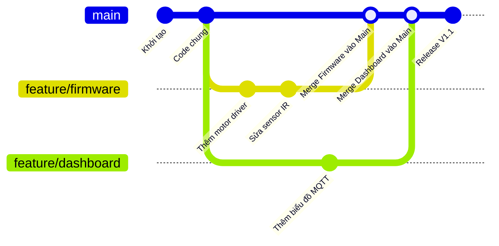

# Cẩm Nang Toàn Diện Về Git & GitHub (Dự Án SortiX-Med / PBL3)

Tài liệu này cung cấp hướng dẫn đầy đủ từ cơ bản đến nâng cao về Git & GitHub: cách sao lưu phiên bản, quy trình làm việc hằng ngày cho nhóm, quản lý nhánh, xử lý xung đột (conflict) và cách sửa sai an toàn.

---

## 📌 PHẦN 1: Cấu Trúc Nhánh Của Dự Án Hiện Tại

- **Repository:** `https://github.com/duyphong375/PBL3-SortiX-Med.git`
- **`main`:** Nhánh chính chứa toàn bộ mã nguồn mới nhất (gồm cả Firmware ESP32, Next.js Dashboard và Dataset YOLO).
- **`backup-v1`:** Nhánh sao lưu đóng băng trạng thái phiên bản cũ trước đợt cập nhật lớn (commit `700f779`).
- **`backup/stable-pre-ui-upgrade`:** Nhánh sao lưu đợt nâng cấp giao diện trước đó.

---

## 📌 PHẦN 2: Các Phương Pháp Sao Lưu Phiên Bản (Backup Strategies)

### Cách 1: Tạo Nhánh Backup Riêng Trên GitHub (Đã Áp Dụng)
Phương pháp này giúp đóng băng trạng thái cũ mà không làm ảnh hưởng đến luồng code mới.

```bash
# 1. Tạo nhánh backup từ một commit hoặc trạng thái hiện tại
git branch backup-v1 <ma-commit-hoac-HEAD>

# 2. Đẩy nhánh backup lên GitHub để lưu trữ vĩnh viễn
git push -u origin backup-v1
```

### Cách 2: Gắn Thẻ Phiên Bản (Git Tag / Release)
Phù hợp khi nhóm bàn giao mốc quan trọng (Báo cáo đợt 1, Demo giữa kỳ, Báo cáo cuối kỳ).

```bash
# Gắn nhãn phiên bản kèm mô tả
git tag -a v1.0.0 -m "Phát hành bản v1.0.0: Hoàn thiện Firmware và Dashboard cơ bản"

# Đẩy thẻ lên GitHub
git push origin v1.0.0

# Nếu muốn đẩy tất cả các tag chưa push:
git push origin --tags
```
> **Xem lại:** Trên GitHub vào mục **Releases** hoặc **Tags** để tải file `.zip` mã nguồn tại thời điểm gắn tag.

### Cách 3: Lấy Lại Code Cũ Từ Lịch Sử Commit
Git lưu lại mọi commit và không bao giờ tự ý xóa dữ liệu cũ.

```bash
# Xem 10 commit gần nhất dạng ngắn gọn
git log --oneline -n 10

# Xem cây lịch sử nhánh trực quan
git log --graph --oneline --all

# Tạo nhánh mới từ commit cũ để chạy lại phiên bản đó:
git checkout -b phuc-hoi-ban-cu <ma-commit>
```

### Cách 4: Sao Lưu Cục Bộ (Local ZIP)
Trước các đợt refactor lớn hoặc trước khi nộp đồ án:
- Nén thư mục dự án thành file `.zip`.
- Có thể xóa hoặc bỏ qua `node_modules/`, `.next/`, `build/` để dung lượng nhẹ hơn.
- Lưu trữ lên Google Drive hoặc OneDrive.

---

## 📌 PHẦN 3: Quy Trình Làm Việc Hằng Ngày (Daily Workflow)

### 1. Thành viên mới Clone dự án về máy
```bash
git clone https://github.com/duyphong375/PBL3-SortiX-Med.git
cd PBL3_NHOM5
```

### 2. Cập nhật code mới nhất từ nhóm trước khi làm việc
Mỗi ngày trước khi bắt đầu code, luôn kéo code mới nhất về:
```bash
# Chuyển về nhánh main
git checkout main

# Kéo toàn bộ cập nhật mới nhất về máy
git pull origin main
```

### 3. Kiểm tra trạng thái code của bạn
```bash
# Xem danh sách file nào đang sửa, file nào chưa được theo dõi
git status

# Xem chi tiết dòng nào vừa được thêm (+) hoặc bớt (-)
git diff
```

### 4. Thêm file và Commit thay đổi
```bash
# Thêm toàn bộ các file đã thay đổi vào Staging Area
git add .

# Hoặc chỉ thêm các file cụ thể:
git add SortiX-Dashboard/frontend/src/app/page.tsx

# Tạo commit kèm thông điệp rõ ràng (chuẩn Conventional Commits)
git commit -m "feat(dashboard): them nut dung khan cap tren TopHeader"
```

### 5. Đẩy code lên GitHub (Tổng Hợp Các Lệnh `git push` Cho Mọi Tình Huống)

#### 5.1. Đẩy code thường ngày lên nhánh `main` (Daily Push)
Sau khi đã hoàn thành `git add .` và `git commit`:
```bash
# Đẩy các commit mới lên nhánh main trên GitHub
git push origin main

# Hoặc nếu nhánh hiện tại đã được cấu hình tracking upstream:
git push
```

#### 5.2. Đẩy code lần đầu tiên khi khởi tạo dự án (First-Time Push & Upstream)
Khi vừa tạo repository mới hoặc liên kết thư mục local với GitHub lần đầu:
```bash
# 1. Liên kết remote origin (nếu chưa liên kết)
git remote add origin https://github.com/duyphong375/PBL3-SortiX-Med.git

# 2. Đổi tên nhánh mặc định thành main (chuẩn GitHub)
git branch -M main

# 3. Đẩy code và thiết lập upstream (-u / --set-upstream)
git push -u origin main
```
> **Ý nghĩa cờ `-u` (upstream):** Lệnh này giúp Git ghi nhớ nhánh `main` ở máy cục bộ sẽ liên kết trực tiếp với `origin/main`. Từ những lần sau, bạn chỉ cần gõ `git push` hoặc `git pull` ngắn gọn mà không cần gõ thêm `origin main`.

#### 5.3. Đẩy một nhánh tính năng mới lên GitHub (Push Feature Branch)
Khi bạn làm việc trên một nhánh riêng (ví dụ `feature/yolo-dataset`, `feature/esp32-encoder`):
```bash
# Đẩy nhánh tính năng lên GitHub và thiết lập tracking:
git push -u origin feature/esp32-encoder

# Hoặc cú pháp đẩy nhánh hiện tại tự động (không cần gõ lại tên nhánh):
git push -u origin HEAD
```

#### 5.4. Đẩy toàn bộ các nhánh cùng lúc lên GitHub
Khi bạn đã tạo hoặc cập nhật nhiều nhánh local và muốn đồng bộ tất cả lên GitHub:
```bash
# Đẩy tất cả các nhánh local lên remote origin
git push origin --all
```

#### 5.5. Đẩy thẻ phiên bản / Release Tags lên GitHub
Sau khi gắn nhãn phiên bản (`git tag`), các tag này **không tự động đẩy lên** bằng lệnh push thông thường mà cần lệnh riêng:
```bash
# Đẩy một tag cụ thể (ví dụ: v1.0.0)
git push origin v1.0.0

# Đẩy TOÀN BỘ các tag chưa có trên GitHub lên cùng một lúc:
git push origin --tags
```

#### 5.6. Đẩy nhánh sao lưu khẩn cấp (Emergency Backup Push)
Trước khi thực hiện các thay đổi lớn, bạn có thể đẩy nhanh trạng thái hiện tại thành một nhánh backup độc lập:
```bash
# Đẩy commit hiện tại thành nhánh backup có tên mới trên GitHub:
git push origin HEAD:backup-truoc-khi-refactor
```

#### 5.7. Xử lý khi bị từ chối Push (`[rejected - non-fast-forward]`)
Lỗi này xảy ra khi **thành viên khác trong nhóm vừa mới đẩy code lên GitHub** trước bạn, khiến nhánh remote có những commit mà máy bạn chưa có.
```bash
# Bước 1: Kéo cập nhật mới nhất từ GitHub về và gộp vào code của bạn
git pull origin main --rebase
# (Hoặc gộp thông thường): git pull origin main

# Bước 2: Xử lý conflict nếu có, sau đó commit

# Bước 3: Đẩy lại lên GitHub bình thường
git push origin main
```

#### 5.8. Xóa nhánh trên GitHub từ máy tính của bạn (Delete Remote Branch)
Khi một nhánh tính năng đã được merge vào `main` và không còn cần thiết:
```bash
# Xóa nhánh feature/esp32-encoder trên GitHub:
git push origin --delete feature/esp32-encoder
```

#### 5.9. Quy tắc an toàn bắt buộc khi Push (Safety Warnings)
> [!CAUTION]
> **Tuyệt đối không dùng `git push --force` (`-f`) lên nhánh `main` dùng chung của nhóm!**  
> Lệnh này sẽ ghi đè lịch sử trên GitHub bằng lịch sử máy bạn, xóa vĩnh viễn các commit mà bạn bè trong nhóm vừa đẩy lên.  
> Nếu bạn buộc phải ép cập nhật trên nhánh cá nhân của mình, hãy dùng cờ an toàn:
> ```bash
> git push --force-with-lease origin <ten-nhanh-rieng>
> ```
> Cờ `--force-with-lease` sẽ tự động hủy lệnh nếu phát hiện có ai khác vừa đẩy commit mới lên nhánh đó, tránh bị ghi đè oan.

---

## 📌 PHẦN 4: Làm Việc Với Nhánh (Branching Workflow Cho Nhóm)

Để tránh xung đột khi nhiều người cùng làm việc (ví dụ 1 người làm Firmware, 1 người làm Giao diện, 1 người train Model):



### 1. Tạo và chuyển sang nhánh tính năng mới
```bash
# Cú pháp: git checkout -b feature/<ten-tinh-nang>
git checkout -b feature/mqtt-telemetry

# Kiểm tra xem mình đang đứng ở nhánh nào (có dấu sao *)
git branch
```

### 2. Đẩy nhánh tính năng lên GitHub
```bash
git push -u origin feature/mqtt-telemetry
```

### 3. Hợp nhất nhánh vào `main`
- **Cách chuyên nghiệp (Khuyên dùng):** Truy cập GitHub, tạo **Pull Request (PR)** từ `feature/mqtt-telemetry` vào `main`, kiểm tra code rồi bấm **Merge**.
- **Cách gộp trực tiếp trên máy cục bộ:**
  ```bash
  # Chuyển về nhánh main
  git checkout main
  git pull origin main

  # Gộp nhánh tính năng vào main
  git merge feature/mqtt-telemetry

  # Đẩy kết quả đã gộp lên GitHub
  git push origin main
  ```

### 4. Xóa nhánh sau khi đã hoàn thành
```bash
# Xóa nhánh trên máy cục bộ
git branch -d feature/mqtt-telemetry

# Xóa nhánh trên GitHub
git push origin --delete feature/mqtt-telemetry
```

---

## 📌 PHẦN 5: Cất Tạm Code Đang Dở Bằng `git stash`

Khi bạn đang viết dở code nhưng cần chuyển sang nhánh khác gấp hoặc cần pull code mới về mà Git báo lỗi xung đột uncommitted:

```bash
# 1. Cất toàn bộ thay đổi chưa commit vào 'túi tạm' (Stash)
git stash push -m "Dang code do sensor logic"

# 2. Bây giờ thư mục đã sạch sẽ, bạn có thể pull hoặc đổi nhánh thoải mái:
git pull origin main
# hoặc git checkout main

# 3. Xem danh sách các lần cất tạm
git stash list

# 4. Lấy lại code đang làm dở ra tiếp tục phát triển:
git stash pop
```

---

## 📌 PHẦN 6: Xử Lý Xung Đột Code (Merge Conflict)

Xung đột xảy ra khi 2 người cùng sửa vào cùng một dòng của cùng một file.

### Dấu hiệu nhận biết:
Git sẽ tạm dừng và đánh dấu trực tiếp vào file:
```text
<<<<<<< HEAD (Code hiện tại trên máy của bạn)
const MQTT_BROKER = "mqtt://192.168.1.100";
=======
const MQTT_BROKER = "mqtt://broker.hivemq.com";
>>>>>>> branch-hoac-commit-khac (Code từ người khác)
```

### Các bước xử lý:
1. Mở file bị conflict trong VS Code.
2. VS Code sẽ hiển thị các lựa chọn nhanh:
   - **Accept Current Change:** Giữ code của bạn.
   - **Accept Incoming Change:** Lấy code của người khác.
   - **Accept Both Changes:** Giữ cả hai.
   - Hoặc tự tay xóa bỏ các ký hiệu `<<<<<<<`, `=======`, `>>>>>>>` và chỉnh sửa thành đoạn code đúng ý muốn.
3. Sau khi sửa xong:
   ```bash
   git add <ten-file-da-sua>
   git commit -m "fix(merge): giai quyet xung dot cau hinh MQTT"
   git push origin <ten-nhanh>
   ```

---

## 📌 PHẦN 7: Sửa Lỗi Và Quay Xe An Toàn (Undo Mistakes)

### 1. Hủy thay đổi của 1 file chưa commit (Trả về bản gốc)
```bash
# Khôi phục 1 file về trạng thái commit gần nhất
git restore path/to/file.c

# Khôi phục toàn bộ mọi file chưa commit:
git restore .
```

### 2. Bỏ file ra khỏi Staging Area (lỡ gõ `git add`)
```bash
git restore --staged path/to/file.c
```

### 3. Sửa lại ghi chú của commit vừa tạo
```bash
git commit --amend -m "Tin nhan commit moi chinh xac hon"
```

### 4. Hủy commit vừa tạo nhưng GIỮ LẠI toàn bộ code đang sửa
```bash
# HEAD~1 nghĩa là lùi lại 1 commit
git reset --soft HEAD~1
```

### 5. Đảo ngược 1 commit đã đẩy lên GitHub (An toàn tuyệt đối cho nhóm)
Lệnh này không xóa commit cũ mà tạo thêm 1 commit mới có nội dung triệt tiêu commit lỗi.
```bash
git revert <ma-commit-can-huy>
git push origin main
```

> ⚠️ **CẢNH BÁO QUAN TRỌNG:**
> - Tuyệt đối **KHÔNG DÙNG** `git reset --hard` nếu bạn chưa backup code, vì lệnh này sẽ xóa vĩnh viễn toàn bộ các thay đổi chưa commit.
> - Tuyệt đối **KHÔNG DÙNG** `git push --force` lên nhánh `main` dùng chung của nhóm vì sẽ ghi đè và làm mất commit của người khác.

---

## 📌 PHẦN 8: Bảng Tra Cứu Nhanh Lệnh Git Thường Dùng

| Thao tác | Lệnh Git | Ghi chú |
| :--- | :--- | :--- |
| **Clone dự án** | `git clone <url>` | Tải repo từ GitHub về máy |
| **Kiểm tra trạng thái** | `git status` | Xem các file modified / untracked |
| **Xem lịch sử** | `git log --oneline -n 10` | Xem 10 commit gần nhất |
| **Cập nhật code** | `git pull origin main` | Kéo code mới nhất từ GitHub |
| **Thêm toàn bộ file** | `git add .` | Đưa mọi file vào hàng đợi commit |
| **Tạo commit** | `git commit -m "thông điệp"` | Lưu lại phiên bản thay đổi |
| **Đẩy code thường ngày** | `git push origin main` (hoặc `git push`) | Đẩy commit lên nhánh main |
| **Đẩy và đặt upstream** | `git push -u origin <branch>` | Nhớ liên kết remote cho lần sau |
| **Đẩy nhánh hiện tại** | `git push -u origin HEAD` | Tự động lấy tên nhánh đang đứng |
| **Đẩy tất cả các nhánh** | `git push origin --all` | Đồng bộ toàn bộ các nhánh local |
| **Đẩy tất cả thẻ tag** | `git push origin --tags` | Đẩy toàn bộ release tags |
| **Đẩy 1 thẻ tag cụ thể** | `git push origin <tag_name>` | Đẩy nhãn phiên bản chỉ định |
| **Xóa nhánh trên GitHub** | `git push origin --delete <branch>` | Xóa nhánh remote từ local |
| **Ép push an toàn (nhánh riêng)** | `git push --force-with-lease origin <branch>` | Ép cập nhật chống ghi đè commit người khác |
| **Tạo và đổi nhánh** | `git checkout -b <branch>` | Tạo nhánh mới |
| **Chuyển nhánh** | `git checkout <branch>` | Đổi sang nhánh đã có |
| **Xem danh sách nhánh** | `git branch -a` | Xem cả nhánh local và remote |
| **Cất tạm code** | `git stash` | Lưu tạm việc đang làm dở |
| **Lấy lại code tạm** | `git stash pop` | Phục hồi việc dở ra tiếp tục |
| **Tạo thẻ phiên bản** | `git tag -a v1.0 -m "ghi chú"` | Đánh dấu bản phát hành |
| **Hủy sửa file chưa commit**| `git restore <file>` | Trả file về nguyên bản |
| **Hủy commit gần nhất** | `git reset --soft HEAD~1` | Giữ lại code nhưng bỏ commit |
